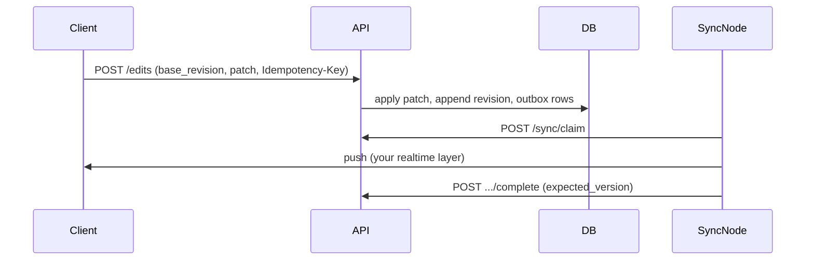

# FastAPI Collaborative Editor

An advanced FastAPI service: async SQLAlchemy, Alembic, JWT auth, **shared documents**,
**optimistic revision checks**, an append-only **edit log**, **Idempotency-Key** on submits,
and **sync nodes** that claim leased **outbox** jobs to push revisions to other collaborators.

Interactive docs: [Swagger UI](/docs) and [ReDoc](/redoc).

## What you get

| Area | Behavior |
|------|----------|
| Infra | Request id middleware, structured logs, liveness/readiness probes |
| Auth | Register, login, refresh rotation, logout (JSON) |
| Documents | Public join, private **404** for non-members, archive |
| Edits | Patch with **base_revision**; stale clients get **409** |
| Idempotency | **Idempotency-Key** on submit — safe retries |
| Sync | Register nodes, **claim** outbox work, **complete** with lease + **expected_version** |
| Cursors | `after_revision` log sync; **last_seen_revision** per member |

## Edit flow



## Project layout

```
app/
  main.py
  models/editor.py
  schemas/editor.py
  services/document_service.py, edit_service.py, sync_service.py
  api/v1/endpoints/   # auth, documents, edits, sync, health
alembic/versions/001_initial_editor.py
tests/api/v1/test_editor_flow.py
```

## Setup

```bash
python -m venv .venv
source .venv/bin/activate
pip install -e ".[dev]"
cp .env.example .env
```

## Run locally

```bash
alembic upgrade head
uvicorn app.main:app --reload
```

Seed once (see distributed-chat README for the seed script pattern) or rely on tests bootstrap.

| | Value |
|--|--------|
| Admin | `admin@example.com` / `AdminPass123!` |
| Public doc | `team-playbook` (revision 1, `Hello team`) |
| Private doc | `private-design-doc` |

## Tests and lint

```bash
pytest -v
ruff check app tests alembic
```

## Docker

```bash
docker compose up --build
```
