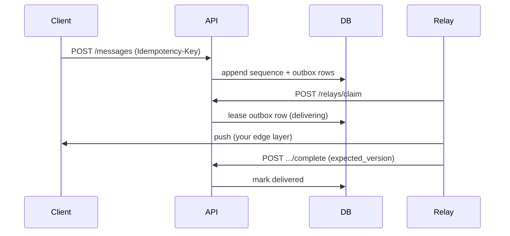

# FastAPI Distributed Chat

An advanced FastAPI service: async SQLAlchemy, Alembic migrations, JWT auth, **chat rooms**,
**monotonic message sequences**, **Idempotency-Key** on sends, **member read cursors**, and
**relay workers** that claim leased **delivery outbox** rows to push messages to connected clients.

Business rules live in services (visibility, membership, outbox enqueue, leases) — not in route handlers alone.

Interactive docs: [Swagger UI](/docs) and [ReDoc](/redoc). **POST .../messages** and relay register include request examples.

## What you get

| Area | Behavior |
|------|----------|
| Infra | Request id middleware, structured logs, liveness/readiness probes |
| Auth | Register, login, refresh rotation, logout (JSON) |
| Rooms | Public discovery + join; private rooms **404** for non-members |
| Messages | Cursor sync via `after_sequence`; sends require **Idempotency-Key** |
| Outbox | One pending row per recipient (excluding author) on each send |
| Relays | Register `room_slugs`, **claim** pending deliveries, **complete** with lease |
| Leases | `RELAY_LEASE_SECONDS` (default 30) — expired leases can be reclaimed |
| Concurrency | **expected_version** on relay complete — stale nodes get **409** |

## Message flow



## Project layout

```
app/
  main.py                     # lifespan, OpenAPI narrative
  db/session.py               # async engine + session factory
  models/chat.py              # rooms, messages, outbox, relays
  schemas/chat.py             # validation + OpenAPI models
  repositories/               # SQLAlchemy queries
  services/                   # rules, idempotency, leases
  api/deps.py                 # DbSession, JWT, Idempotency-Key
  api/v1/endpoints/           # auth, rooms, messages, relays, health
alembic/versions/             # 001_initial_chat.py
tests/api/v1/                 # chat flow, health
```

## Setup

```bash
python -m venv .venv
source .venv/bin/activate
pip install -e ".[dev]"
cp .env.example .env
```

## Run locally

```bash
alembic upgrade head
uvicorn app.main:app --reload
```

Seed reference data once after migrate:

```bash
python -c "
import asyncio
from app.core.config import get_settings
from app.db.seed import seed_reference_data
from app.db.session import make_engine, make_session_factory

async def main():
    engine = make_engine(get_settings().database_url)
    factory = make_session_factory(engine)
    async with factory() as session:
        await seed_reference_data(session)
    await engine.dispose()

asyncio.run(main())
"
```

| URL | Purpose |
|-----|---------|
| http://127.0.0.1:8000/docs | Swagger UI |
| http://127.0.0.1:8000/api/v1/health/live | Process is up |
| http://127.0.0.1:8000/api/v1/health/ready | Database accepts `SELECT 1` |

### Seed credentials

- **Admin:** `admin@example.com` / `AdminPass123!`
- **Public room:** `general` (welcome message at sequence 1)
- **Private room:** `private-ops` (admin member only)

## Typical walkthrough

1. `POST /api/v1/auth/login` — obtain bearer token.
2. `GET /api/v1/rooms` — discover `general`.
3. `POST /api/v1/rooms/general/join` — become a member.
4. `GET /api/v1/rooms/general/messages?after_sequence=0` — sync history.
5. `POST /api/v1/rooms/general/messages` with `Idempotency-Key` — send; outbox rows enqueue for other members.
6. `POST /api/v1/relays/register` then `/claim` and `/deliveries/{id}/complete` — simulate edge delivery.

## Run with Postgres

```bash
cp .env.example .env
docker compose up --build
```

## Tests and lint

```bash
pytest -v
ruff check app tests alembic
```

Tests bootstrap in-memory SQLite, create tables, and seed — no local `chat.db` required.
