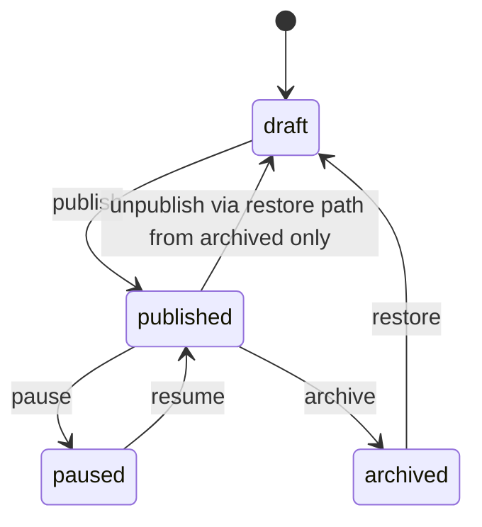
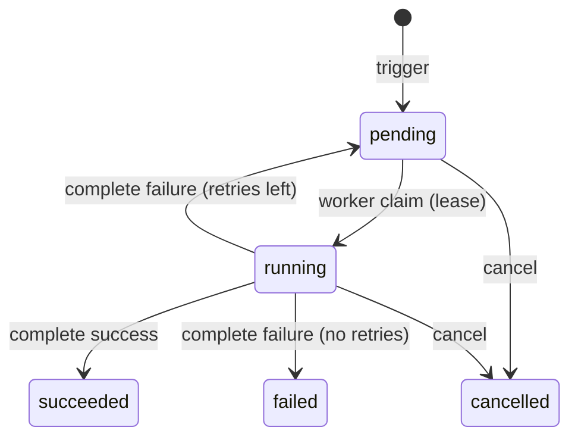

# FastAPI Distributed Scheduler

An advanced FastAPI service: async SQLAlchemy, Alembic migrations, JWT auth, **schedule definitions**,
**scheduled runs**, **worker registration**, **lease-based claiming**, **Idempotency-Key** on triggers,
and **expected_version** when completing work.

Services enforce publish rules, run privacy, lease ownership, and retries — not route handlers alone.

Interactive docs: [Swagger UI](/docs) and [ReDoc](/redoc). **POST /api/v1/schedules** and
**POST .../trigger** include request examples.

## What you get

| Area | Behavior |
|------|----------|
| Infra | Request id middleware, structured logs, liveness/readiness probes |
| Auth | Register, login, refresh rotation, logout (JSON) |
| Schedules | Cron or interval definitions; draft → published → paused/archived |
| Trigger | Enqueue a run on a **published** schedule (`Idempotency-Key` required) |
| Workers | Register capabilities, heartbeat, **claim** pending work, **complete** with lease |
| Leases | `WORKER_LEASE_SECONDS` (default 30) — expired leases can be reclaimed |
| Retries | Failed completions re-queue until `max_attempts` |
| Privacy | Another user's run id returns **404**, not **403** |

## Schedule lifecycle



Only **published** schedules accept manual triggers.

## Run lifecycle



## Project layout

```
app/
  main.py                     # lifespan, OpenAPI narrative
  db/session.py               # async engine + session factory
  models/scheduler.py         # schedules, runs, worker_nodes
  schemas/scheduler.py        # validation + OpenAPI models
  repositories/               # SQLAlchemy queries
  services/                   # rules, idempotency, leases
  api/deps.py                 # DbSession, JWT, Idempotency-Key
  api/v1/endpoints/           # auth, schedules, runs, workers, health
alembic/versions/             # 001_initial_scheduler.py
tests/api/v1/                 # auth, scheduler flow, health
```

## Setup

```bash
python -m venv .venv
source .venv/bin/activate
pip install -e ".[dev]"
cp .env.example .env
```

## Run locally

```bash
alembic upgrade head
uvicorn app.main:app --reload
```

Seed reference data once after migrate:

```bash
python -c "
import asyncio
from app.core.config import get_settings
from app.db.seed import seed_reference_data
from app.db.session import make_engine, make_session_factory

async def main():
    engine = make_engine(get_settings().database_url)
    factory = make_session_factory(engine)
    async with factory() as session:
        await seed_reference_data(session)
    await engine.dispose()

asyncio.run(main())
"
```

| Account / schedule | Value |
|--------------------|--------|
| Admin | `admin@example.com` / `AdminPass123!` |
| Published | `nightly-report` (`task_type`: `report`) |
| Draft | `draft-cleanup` (404 on trigger without admin) |

## Walkthrough

**Trigger → claim → complete**

```bash
TOKEN=$(curl -s -X POST http://127.0.0.1:8000/api/v1/auth/login \
  -H "Content-Type: application/json" \
  -d '{"email":"admin@example.com","password":"AdminPass123!"}' | jq -r .access_token)

curl -s -X POST http://127.0.0.1:8000/api/v1/schedules/nightly-report/trigger \
  -H "Authorization: Bearer $TOKEN" \
  -H "Idempotency-Key: demo-1" \
  -H "Content-Type: application/json" \
  -d '{"payload":{"report_name":"demo"}}'

curl -s -X POST http://127.0.0.1:8000/api/v1/workers/register \
  -H "Authorization: Bearer $TOKEN" \
  -H "Content-Type: application/json" \
  -d '{"worker_id":"local-1","capabilities":["report"]}'

RUN_ID=$(curl -s -X POST http://127.0.0.1:8000/api/v1/workers/claim \
  -H "Authorization: Bearer $TOKEN" \
  -H "Content-Type: application/json" \
  -d '{"worker_id":"local-1"}' | jq -r .id)

curl -s -X POST "http://127.0.0.1:8000/api/v1/workers/runs/$RUN_ID/complete" \
  -H "Authorization: Bearer $TOKEN" \
  -H "Content-Type: application/json" \
  -d '{"worker_id":"local-1","expected_version":2,"outcome":"success","result":{"ok":true}}'
```

## Tests and lint

```bash
pytest -v
ruff check app tests alembic
```

Tests use in-memory SQLite, bootstrap tables, and `seed_reference_data` — no Postgres required.
