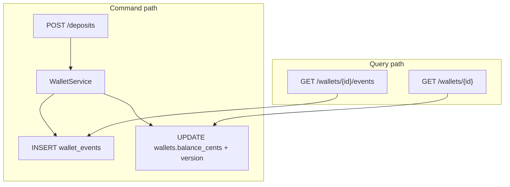

# FastAPI Event-Sourced Wallet

An advanced FastAPI service that models wallets with **append-only events**, a **balance projection**, JWT auth, **idempotent commands**, and **optimistic concurrency**. Async SQLAlchemy + Alembic; local SQLite or Compose Postgres.

The teaching goal is to see event sourcing without a separate broker: the `wallet_events` table is the source of truth, and the `wallets` row is a read model updated in the same transaction as each append.

Interactive docs: [Swagger UI](/docs) and [ReDoc](/redoc).

## What you get

| Area | Behavior |
|------|----------|
| Auth | Register, login, refresh, logout, `GET /api/v1/auth/me` (JSON login) |
| Wallets | Create (idempotent), list, get balance projection |
| Event stream | `GET /wallets/{id}/events` ordered by `sequence` |
| Deposits / withdrawals | Append `money_deposited` / `money_withdrawn` with `expected_version` |
| Transfers | Paired `transfer_out` + `transfer_in` in one DB transaction |
| Idempotency | `Idempotency-Key` header on all mutating wallet routes |
| Concurrency | Stale `expected_version` → **409** |
| Privacy | Another user's wallet id → **404** |
| Ops | Request id middleware, live/ready health, structured logs |

## Event types

| `event_type` | Effect on balance |
|--------------|-------------------|
| `wallet_created` | Starts at 0 |
| `money_deposited` | + `amount_cents` |
| `money_withdrawn` | − `amount_cents` (409 if insufficient) |
| `transfer_out` | − `amount_cents` on source |
| `transfer_in` | + `amount_cents` on destination |

Each wallet has a monotonic `sequence` (stored as `wallets.version` on the projection).



## Project layout

```
app/
  main.py                     # OpenAPI narrative, lifespan, middleware
  core/                       # settings, JWT, AppError, logging
  db/session.py               # async engine
  db/bootstrap.py             # create_all for tests
  db/seed.py                  # admin + Demo Treasury wallet + seed events
  models/wallet.py            # Wallet projection + WalletEvent stream
  services/wallet_projection.py   # pure apply_event (replay rules)
  services/wallet_service.py      # append, idempotency, transfers
  api/v1/endpoints/wallets.py
alembic/versions/001_initial_wallet.py
tests/api/v1/test_wallet_flow.py
```

## Setup

```bash
python -m venv .venv
source .venv/bin/activate
pip install -e ".[dev]"
cp .env.example .env
alembic upgrade head
uvicorn app.main:app --reload
```

| URL | Purpose |
|-----|---------|
| http://127.0.0.1:8000/docs | Swagger UI |
| http://127.0.0.1:8000/api/v1/health/live | Liveness |
| http://127.0.0.1:8000/api/v1/health/ready | DB readiness |

## Walkthrough

**Login (seed admin)**

```bash
TOKEN=$(curl -s -X POST http://127.0.0.1:8000/api/v1/auth/login \
  -H 'Content-Type: application/json' \
  -d '{"email":"admin@example.com","password":"AdminPass123!"}' | jq -r .access_token)

curl -s http://127.0.0.1:8000/api/v1/wallets -H "Authorization: Bearer $TOKEN"
```

**Create a wallet (idempotent)**

```bash
curl -s -X POST http://127.0.0.1:8000/api/v1/wallets \
  -H "Authorization: Bearer $TOKEN" \
  -H "Idempotency-Key: create-personal-1" \
  -H 'Content-Type: application/json' \
  -d '{"name":"Personal","currency":"USD"}'
```

Note the returned `id` and `version` (1 after `wallet_created`).

**Deposit**

```bash
WALLET_ID=<uuid-from-create>
curl -s -X POST "http://127.0.0.1:8000/api/v1/wallets/$WALLET_ID/deposits" \
  -H "Authorization: Bearer $TOKEN" \
  -H "Idempotency-Key: dep-001" \
  -H 'Content-Type: application/json' \
  -d '{"amount_cents":2500,"expected_version":1,"memo":"Allowance"}'
```

**Read the event stream**

```bash
curl -s "http://127.0.0.1:8000/api/v1/wallets/$WALLET_ID/events" \
  -H "Authorization: Bearer $TOKEN"
```

## API reference

| Method | Path | Headers | Description |
|--------|------|---------|-------------|
| POST | `/api/v1/auth/register` | — | Create account |
| POST | `/api/v1/auth/login` | — | JSON login → token pair |
| GET | `/api/v1/wallets` | Bearer | List wallets |
| GET | `/api/v1/wallets/{id}` | Bearer | Balance projection |
| GET | `/api/v1/wallets/{id}/events` | Bearer | Append-only stream |
| POST | `/api/v1/wallets` | Bearer + Idempotency-Key | Create wallet |
| POST | `/api/v1/wallets/{id}/deposits` | Bearer + Idempotency-Key | Deposit |
| POST | `/api/v1/wallets/{id}/withdrawals` | Bearer + Idempotency-Key | Withdraw |
| POST | `/api/v1/wallets/transfers` | Bearer + Idempotency-Key | Transfer |

## Where the rules live

| Rule | Location |
|------|----------|
| Balance math / insufficient funds | `app/services/wallet_projection.py` |
| Append + version check | `WalletService._append`, `_check_version` |
| Idempotent replay | `WalletService._load_idempotent*` |
| Row-level lock on writes | `WalletRepository.get_for_update` |
| Wallet privacy | `WalletService._can_view` |

## Tests and lint

```bash
pytest -v
ruff check app tests alembic
```

Tests use in-memory SQLite, `create_all`, and the same seed as local dev.

## Docker

```bash
docker compose up --build
```

Compose runs migrations before uvicorn, same as `scripts/start.sh`.

## What this demo is not

There is no outbox, snapshotting, or cross-aggregate saga beyond the paired transfer events. Production systems might rebuild projections from the stream in a worker, store snapshots, or publish events to Kafka — the **append + apply** split in this repo is the piece to keep.
