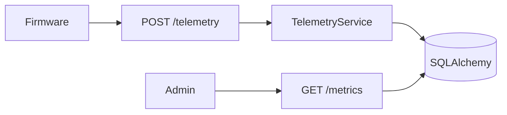

# FastAPI IoT Telemetry

An advanced FastAPI service for **device provisioning**, **telemetry ingest**, **metrics**, and **threshold alerts**. It keeps the starter wiring — async SQLAlchemy, Alembic, structured logs, request ids, health probes — and adds an IoT-shaped domain you can trace in `/docs`.

Local runs use SQLite (`./iot-telemetry.db`). Docker Compose runs the same code against Postgres.

## What you get

| Area | Behavior |
|------|----------|
| Devices | Admin provision, suspend, resume, decommission |
| Ingest | Per-device **X-Device-Token** + **Idempotency-Key** |
| Metrics | Overview, numeric/boolean time series by `metric_key` |
| Alerts | Per-device rules; evaluate max in window vs threshold |
| Health | Live (no DB) and ready (`SELECT 1`) |
| Errors | `AppError` → `{"detail": "..."}` |

## Keys

| Header | Used for |
|--------|----------|
| `X-Admin-Key` | Devices, metrics, alerts |
| `X-Device-Token` | POST telemetry for that device |
| `Idempotency-Key` | Required on ingest |

Defaults in `.env.example` are for local dev only.

## Quick start

```bash
cd advanced/fastapi-iot-telemetry
python -m venv .venv && source .venv/bin/activate
pip install -e ".[dev]"
cp .env.example .env
alembic upgrade head
python scripts/seed_data.py
uvicorn app.main:app --reload
```

### Seed device (after `seed_data.py`)

| Device key | Ingest token |
|------------|----------------|
| `warehouse-temp-01` | `seed-token-warehouse-temp-01` |

Example ingest:

```bash
curl -s -X POST "http://127.0.0.1:8000/api/v1/devices/warehouse-temp-01/telemetry" \
  -H "X-Device-Token: seed-token-warehouse-temp-01" \
  -H "Idempotency-Key: demo-1" \
  -H "Content-Type: application/json" \
  -d '{"metrics":{"temp_c":21.2,"humidity_pct":39}}'
```

(Admin key is not required for ingest — only device token and idempotency.)

## Suggested walkthrough (Swagger)

1. **List devices** — `GET /api/v1/devices` with `X-Admin-Key`.
2. **Overview** — `GET /api/v1/devices/warehouse-temp-01/metrics/overview`.
3. **Ingest** — `POST .../telemetry` with device token headers (use Authorize only for admin routes).
4. **Series** — `GET .../metrics/series?metric_key=temp_c`.
5. **Alerts** — `GET .../alerts/evaluate`.
6. **Provision** — `POST /api/v1/devices` and save the one-time `ingest_token`.

## Layout

```
app/
  models/telemetry.py       # devices, readings, idempotency, alert rules
  services/                 # device, telemetry, metrics, alerts
  api/v1/endpoints/         # devices, telemetry, metrics, alerts, health
  db/bootstrap.py           # create_all for tests
  db/seed.py                # demo fleet
alembic/versions/001_initial_iot.py
```



## Postgres

```bash
docker compose up --build
```

## Tests

```bash
pytest -v
ruff check app tests alembic
```

Tests bootstrap in-memory SQLite and seed data automatically.
