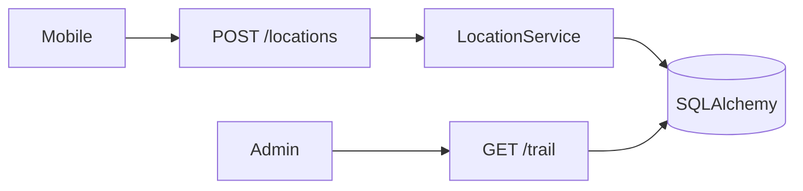

# FastAPI Location Tracking

An advanced FastAPI service for **tracker provisioning**, **GPS ingest**, **location trails**, **circular geofences**, and **enter/exit events**. It keeps the starter wiring — async SQLAlchemy, Alembic, structured logs, request ids, health probes — and adds a fleet-tracking domain you can trace in `/docs`.

Local runs use SQLite (`./location-tracking.db`). Docker Compose runs the same code against Postgres.

## What you get

| Area | Behavior |
|------|----------|
| Trackers | Admin provision, suspend, resume, overview |
| Ingest | Per-tracker **X-Tracker-Token** + **Idempotency-Key** |
| Trails | Admin time-window history by `recorded_at` |
| Geofences | Circular regions; monitors link trackers |
| Events | Enter/exit on ingest; historical list per tracker |
| Health | Live (no DB) and ready (`SELECT 1`) |
| Errors | `AppError` → `{"detail": "..."}` |

## Keys

| Header | Used for |
|--------|----------|
| `X-Admin-Key` | Trackers, geofences, monitors, trails, events |
| `X-Tracker-Token` | POST locations for that tracker |
| `Idempotency-Key` | Required on ingest |

Defaults in `.env.example` are for local dev only.

## Quick start

```bash
cd advanced/fastapi-location-tracking
python -m venv .venv && source .venv/bin/activate
pip install -e ".[dev]"
cp .env.example .env
alembic upgrade head
python scripts/seed_data.py
uvicorn app.main:app --reload
```

### Seed tracker (after `seed_data.py`)

| Tracker key | Ingest token |
|-------------|----------------|
| `delivery-van-01` | `seed-token-delivery-van-01` |

Example ingest:

```bash
curl -s -X POST "http://127.0.0.1:8000/api/v1/trackers/delivery-van-01/locations" \
  -H "X-Tracker-Token: seed-token-delivery-van-01" \
  -H "Idempotency-Key: demo-1" \
  -H "Content-Type: application/json" \
  -d '{"latitude":37.775,"longitude":-122.4194,"accuracy_m":8}'
```

(Admin key is not required for ingest — only tracker token and idempotency.)

## Suggested walkthrough (Swagger)

1. **List trackers** — `GET /api/v1/trackers` with `X-Admin-Key`.
2. **Overview** — `GET /api/v1/trackers/delivery-van-01/overview`.
3. **Ingest** — `POST .../locations` with tracker token headers.
4. **Trail** — `GET .../locations/trail?window_minutes=120`.
5. **Geofences** — `GET /api/v1/geofences` and create a new region.
6. **Monitor** — `POST /api/v1/trackers/{key}/monitors` with `geofence_id`.
7. **Events** — `GET /api/v1/trackers/{key}/geofence-events`.
8. **Provision** — `POST /api/v1/trackers` and save the one-time `ingest_token`.

## Layout

```
app/
  models/tracking.py        # trackers, pings, geofences, events
  core/geo.py               # Haversine distance helpers
  services/                 # tracker, location, geofence
  api/v1/endpoints/         # trackers, locations, geofences, events, health
  db/bootstrap.py           # create_all for tests
  db/seed.py                # demo fleet
alembic/versions/001_initial_location.py
```



## Postgres

```bash
docker compose up --build
```

## Tests

```bash
pytest -v
ruff check app tests alembic
```

Tests bootstrap in-memory SQLite and seed data automatically.
