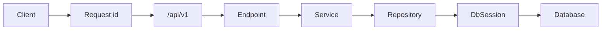

# FastAPI Realtime Analytics

An advanced FastAPI service for **event ingestion**, **rolling metrics**, and **threshold alerts** on named streams. It keeps the starter wiring — async SQLAlchemy, Alembic, structured logs, request ids, health probes — and adds a teaching domain you can trace in `/docs`.

Local runs use SQLite (`./analytics.db`). Docker Compose runs the same code against Postgres.

## What you get

| Area | Behavior |
|------|----------|
| Streams | Admin CRUD, pause/resume ingestion per stream key |
| Ingest | Single + batch events with **X-Ingest-Key** and **Idempotency-Key** |
| Dedupe | Optional `dedupe_key` per event (unique per stream) |
| Metrics | 15-minute overview + bucketed time series by `occurred_at` |
| Alerts | Rules that fire when recent volume crosses a threshold |
| Health | Live (no DB) and ready (`SELECT 1`) |
| Errors | `AppError` → `{"detail": "..."}` with 401, 403, 404, 409 |

## API keys

| Header | Used for |
|--------|----------|
| `X-Admin-Key` | Streams, metrics, alerts |
| `X-Ingest-Key` | POST events |
| `Idempotency-Key` | Required on ingest (retry-safe) |

Defaults in `.env.example`:

- `INGEST_API_KEY=dev-ingest-key-change-me`
- `ADMIN_API_KEY=dev-admin-key-change-me`

## Quick start

```bash
cd advanced/fastapi-realtime-analytics
python -m venv .venv && source .venv/bin/activate
pip install -e ".[dev]"
cp .env.example .env
alembic upgrade head
python scripts/seed_data.py
uvicorn app.main:app --reload
```

Open http://127.0.0.1:8000/docs.

### Suggested Swagger walkthrough

1. **List streams** — `GET /api/v1/streams` with `X-Admin-Key`.
2. **Overview** — `GET /api/v1/streams/web-traffic/metrics/overview`.
3. **Ingest** — `POST /api/v1/streams/web-traffic/events` with ingest + idempotency headers.
4. **Retry** — repeat the same ingest; response body matches the first call.
5. **Paused stream** — `POST /api/v1/streams/checkout/events` returns **409**.
6. **Alerts** — `GET /api/v1/streams/web-traffic/alerts/evaluate`.

Seed data (via `app/db/seed.py` after tables exist): `web-traffic` (12 events), `checkout` (paused).

## Layout

```
app/
  main.py                     # OpenAPI narrative, lifespan, middleware
  models/analytics.py         # streams, events, idempotency, alert rules
  repositories/               # async SQLAlchemy queries
  services/                   # ingest rules, rollups, alert evaluation
  api/v1/endpoints/           # streams, events, metrics, alerts, health
  db/bootstrap.py             # create_all for tests
  db/seed.py                  # demo streams and events
alembic/versions/001_initial_analytics.py
tests/api/v1/test_analytics_flow.py
```

### Request path



Ingest routes stay thin: keys are validated in dependencies; **EventService** enforces pause state, idempotency, and dedupe.

## Postgres

```bash
docker compose up --build
```

Compose sets `DATABASE_URL` to `postgresql+asyncpg://analytics:analytics@db:5432/analytics` and runs migrations before uvicorn.

## Tests and lint

```bash
pytest -v
ruff check app tests alembic
```

Tests use in-memory SQLite, bootstrap tables, and seed data — no `.env` database required.
