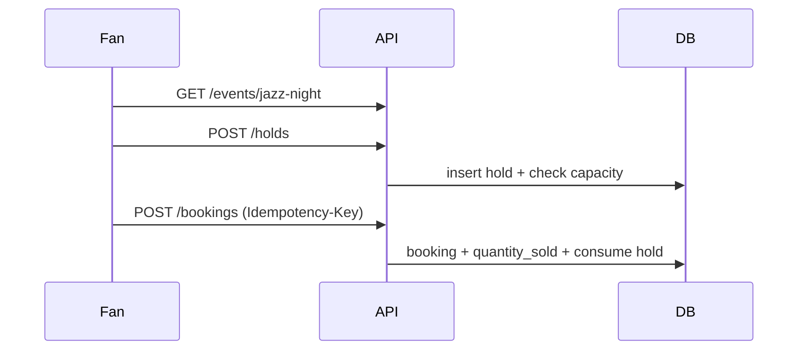

# FastAPI Ticket Booking

An **advanced** sample for selling event tickets without overselling: async SQLAlchemy, **timed holds**, **live availability**, and **idempotent checkout**.

Interactive docs: [Swagger UI](/docs) and [ReDoc](/redoc).

## Patterns

| Pattern | Where |
|---------|--------|
| Timed hold | `POST /api/v1/holds` — capacity reserved until `expires_at` |
| Lazy expiry | `HoldRepository.expire_stale()` on reads/writes |
| Availability math | `capacity - quantity_sold - active_holds` |
| Idempotent checkout | `Idempotency-Key` on `POST /api/v1/bookings` |
| Publish workflow | Draft events hidden (**404**) until admin publishes |

## Flow



## Endpoints

| Area | Routes |
|------|--------|
| Auth | `/api/v1/auth/*` |
| Venues & events | `/api/v1/venues`, `/api/v1/events`, publish, tiers |
| Holds | `/api/v1/holds`, `/api/v1/holds/mine`, release |
| Bookings | `/api/v1/bookings`, confirm, cancel |

## Setup

```bash
pip install -e ".[dev]"
cp .env.example .env
alembic upgrade head
uvicorn app.main:app --reload
```

Tests bootstrap schema + seed automatically.

## Seed

- Admin: `admin@example.com` / `AdminPass123!`
- Published event: **`jazz-night`** at Grand Hall (General 100 @ $35, VIP 20 @ $95)

## Example

```bash
TOKEN=$(curl -s -X POST http://127.0.0.1:8000/api/v1/auth/login \
  -H 'Content-Type: application/json' \
  -d '{"email":"fan@example.com","password":"SecurePass123!"}' | jq -r .access_token)

curl -s -X POST http://127.0.0.1:8000/api/v1/holds \
  -H "Authorization: Bearer $TOKEN" \
  -H 'Content-Type: application/json' \
  -d '{"tier_id":1,"quantity":2}'

curl -s -X POST http://127.0.0.1:8000/api/v1/bookings \
  -H "Authorization: Bearer $TOKEN" \
  -H 'Idempotency-Key: demo-checkout' \
  -H 'Content-Type: application/json' \
  -d '{"hold_id":1}'
```

## Where rules live

| Rule | Module |
|------|--------|
| Hold TTL | `Settings.hold_ttl_minutes`, `HoldService.create_hold` |
| Expire stale holds | `HoldRepository.expire_stale` |
| Confirm from hold | `BookingService.confirm` |
| Restock on cancel | `BookingService.cancel` |
| Draft visibility | `_can_view` in `EventService` |

## Tests

```bash
pytest -v
ruff check app tests
```
