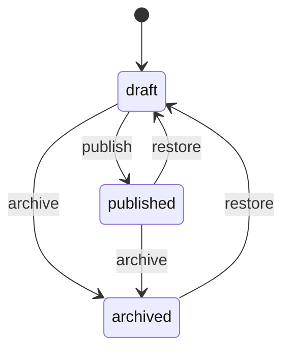
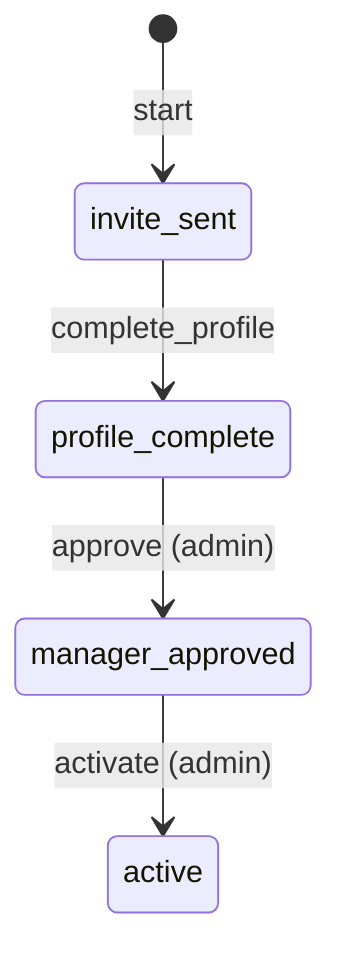
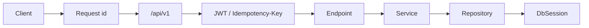

# FastAPI Workflow Engine

An advanced FastAPI service: async SQLAlchemy, Alembic migrations, JWT auth, **workflow definitions**
(state graphs), **running instances**, append-only **event history**, **Idempotency-Key** on commands,
and **expected_version** optimistic concurrency.

Definitions describe legal moves. Instances carry runtime state. Services enforce the graph, roles on
transitions, and privacy — not the route handlers alone.

Interactive docs: [Swagger UI](/docs) and [ReDoc](/redoc). **POST /api/v1/workflow-instances** and
**POST .../transitions** include request examples.

## What you get

| Area | Behavior |
|------|----------|
| Infra | Request id middleware, structured logs, liveness/readiness probes |
| Auth | Register, login, refresh rotation, logout (`JSON` bodies, not form login) |
| Definitions | Admin-authored `states`, `transitions`, `terminal_states`; publish/archive lifecycle |
| Visibility | Draft/archived definitions return **404** to non-admins |
| Instances | Start from **published** definitions; context JSON bag on the instance |
| History | `GET .../events` ordered by `sequence` (`instance_started`, `state_changed`) |
| Roles | Transitions may require `admin` (seed onboarding uses admin for approve/activate) |
| Idempotency | **Idempotency-Key** on start and transition — safe retries return the same body |
| Concurrency | **expected_version** on transitions — stale version returns **409** |
| Privacy | Another user's instance id returns **404**, not **403** |

## Definition lifecycle



Only **published** definitions may start new instances.

## Instance lifecycle (seed `employee-onboarding`)



Entering `active` (a terminal state) sets instance status to **completed**.

## Project layout

```
app/
  main.py                     # lifespan, OpenAPI narrative, probes
  db/session.py               # async engine + session factory
  models/workflow.py          # definitions, instances, events
  schemas/workflow.py         # graph validation in Pydantic
  repositories/               # SQLAlchemy queries
  services/                   # rules, idempotency, locking
  api/deps.py                 # DbSession, JWT, Idempotency-Key
  api/v1/endpoints/           # auth, definitions, instances, health
alembic/versions/             # 001_initial_workflow_engine.py
tests/api/v1/                 # auth, workflow flow, health
```

### Request path



## Setup

```bash
python -m venv .venv
source .venv/bin/activate
pip install -e ".[dev]"
cp .env.example .env
```

## Run locally

```bash
alembic upgrade head
uvicorn app.main:app --reload
```

Seed rows (admin + workflows) are inserted by tests via `app/db/seed.py`. For a local database after
migrate, run once:

```bash
python -c "
import asyncio
from app.core.config import get_settings
from app.db.seed import seed_reference_data
from app.db.session import make_engine, make_session_factory

async def main():
    engine = make_engine(get_settings().database_url)
    factory = make_session_factory(engine)
    async with factory() as session:
        await seed_reference_data(session)
    await engine.dispose()

asyncio.run(main())
"
```

| URL | Purpose |
|-----|---------|
| http://127.0.0.1:8000/docs | Swagger UI |
| http://127.0.0.1:8000/api/v1/health/live | Liveness |
| http://127.0.0.1:8000/api/v1/health/ready | Readiness (`SELECT 1`) |

Seed accounts and workflows:

| | Value |
|--|--------|
| Admin | `admin@example.com` / `AdminPass123!` |
| Published | `employee-onboarding` |
| Draft (404 for guests) | `draft-internal` |

## Walkthrough

**List published definitions (no token)**

```bash
curl -s http://127.0.0.1:8000/api/v1/workflow-definitions
```

**Register and start an instance**

```bash
curl -s -X POST http://127.0.0.1:8000/api/v1/auth/register \
  -H 'Content-Type: application/json' \
  -d '{"email":"you@example.com","password":"SecurePass1!","full_name":"You"}'

TOKEN=$(curl -s -X POST http://127.0.0.1:8000/api/v1/auth/login \
  -H 'Content-Type: application/json' \
  -d '{"email":"you@example.com","password":"SecurePass1!"}' | jq -r .access_token)

curl -s -X POST http://127.0.0.1:8000/api/v1/workflow-instances \
  -H "Authorization: Bearer $TOKEN" \
  -H 'Idempotency-Key: start-demo-1' \
  -H 'Content-Type: application/json' \
  -d '{"definition_slug":"employee-onboarding","context":{"employee_email":"you@example.com"}}'
```

**Advance state (note `expected_version`)**

```bash
curl -s -X POST http://127.0.0.1:8000/api/v1/workflow-instances/1/transitions \
  -H "Authorization: Bearer $TOKEN" \
  -H 'Idempotency-Key: tx-profile' \
  -H 'Content-Type: application/json' \
  -d '{"action":"complete_profile","expected_version":1,"context_patch":{"profile_completed":true}}'
```

Admin token required for `approve` and `activate` on the seed graph.

## API reference

| Method | Path | Who | Description |
|--------|------|-----|-------------|
| GET | `/api/v1/workflow-definitions` | Public (+ optional bearer) | Published defs; admin may filter `status` |
| GET | `/api/v1/workflow-definitions/{slug}` | Public (+ optional bearer) | One definition; hidden rows are 404 |
| POST | `/api/v1/workflow-definitions` | Admin | Create draft |
| PATCH | `/api/v1/workflow-definitions/{slug}` | Admin | Edit draft graph |
| POST | `/api/v1/workflow-definitions/{slug}/publish` | Admin | Publish |
| POST | `/api/v1/workflow-definitions/{slug}/archive` | Admin | Archive |
| POST | `/api/v1/workflow-definitions/{slug}/restore` | Admin | Archived → draft |
| GET | `/api/v1/workflow-instances` | Bearer | List instances |
| GET | `/api/v1/workflow-instances/{id}` | Bearer | One instance (404 for others) |
| GET | `/api/v1/workflow-instances/{id}/events` | Bearer | Event history |
| POST | `/api/v1/workflow-instances` | Bearer + Idempotency-Key | Start instance |
| POST | `/api/v1/workflow-instances/{id}/transitions` | Bearer + Idempotency-Key | Fire action |

## Where the rules live

| Rule | Location |
|------|----------|
| Graph validation on create | `WorkflowDefinitionCreate` in `app/schemas/workflow.py` |
| Draft visibility | `definition_can_view` in `app/services/workflow_helpers.py` |
| Transition guard + roles | `InstanceService.transition`, `actor_may_fire` |
| Optimistic locking | `expected_version` check in `InstanceService.transition` |
| Idempotent commands | `IdempotencyRepository` + `_load_idempotent` in `InstanceService` |
| Append-only history | `WorkflowEvent` rows in `app/models/workflow.py` |

## Tests and lint

```bash
pytest -v
ruff check app tests alembic
```

## Docker / Postgres

```bash
docker compose up --build
```

Compose runs `alembic upgrade head` before uvicorn (see `scripts/start.sh`).

## What this demo is not

There is no worker queue, timer transitions, or human task inbox UI. Production workflow engines add
durable schedulers, outbox dispatch, and often separate read models — the **service layer** here is
where those concerns would attach without changing the HTTP contract.
