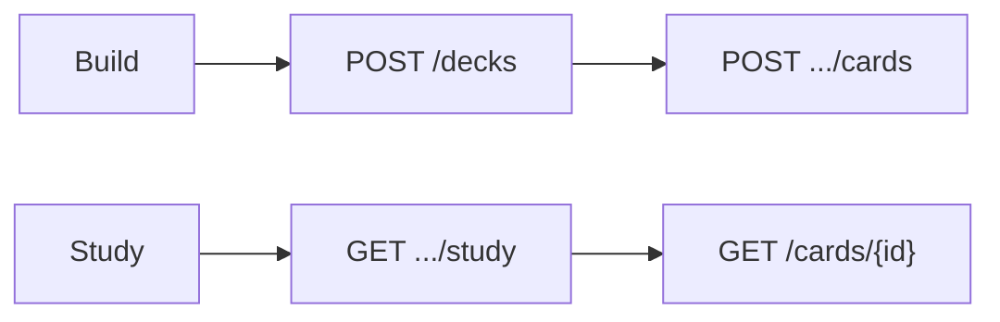

# FastAPI Flashcards

A beginner-friendly FastAPI service for **decks** and **flashcards**: build front/back cards, run a **study** session that hides answers, and **flip** individual cards to reveal them. Everything is in memory (data resets when the process restarts).

Interactive docs: [Swagger UI](/docs) and [ReDoc](/redoc). OpenAPI text in `app/main.py` describes the study flow; deck and card create bodies include **Examples** in Swagger.

## What you get

| Area | Behavior |
|------|----------|
| Decks | List, create, get (with all cards), patch, delete (cascades cards) |
| Cards | Add to a deck; get / patch / delete by card id |
| Study | `GET .../study` — front + hint only, no `back` |
| Flip | `GET /cards/{id}` — full card after the learner guesses |
| Errors | **404** with `{"detail": "..."}` |

## Seed data

| Deck | Title | Cards |
|------|-------|-------|
| `1` | Spanish basics | Hola → Hello, Gracias, Adiós |
| `2` | HTTP verbs | GET, POST |

## Setup

```bash
cd beginner/fastapi-flashcards
python -m venv .venv && source .venv/bin/activate
pip install -e ".[dev]"
cp .env.example .env
uvicorn app.main:app --reload
```

| URL | Purpose |
|-----|---------|
| http://127.0.0.1:8000/docs | Swagger UI |
| http://127.0.0.1:8000/redoc | ReDoc |

## Study flow (curl)

```bash
# Fronts only
curl -s http://127.0.0.1:8000/api/v1/decks/1/study

# Reveal card 1
curl -s http://127.0.0.1:8000/api/v1/cards/1
```

## Suggested walkthrough in Swagger

1. **GET /api/v1/decks** — see seed decks and `card_count`.
2. **GET /api/v1/decks/1/study** — note there is no `back` on cards.
3. **GET /api/v1/cards/1** — flip to the answer.
4. **POST /api/v1/decks** then **POST .../cards** — build your own deck.

## Layout

```
app/
  main.py
  schemas/flashcard.py
  repositories/flashcard_repository.py
  services/flashcard_service.py
  api/v1/endpoints/       # decks, cards, health
tests/api/v1/
```



## API reference

| Method | Path | Description |
|--------|------|-------------|
| GET | `/api/v1/health` | Liveness |
| GET | `/api/v1/decks` | List decks |
| POST | `/api/v1/decks` | Create deck |
| GET | `/api/v1/decks/{id}` | Deck + all cards (with backs) |
| PATCH | `/api/v1/decks/{id}` | Update title / description |
| DELETE | `/api/v1/decks/{id}` | Delete deck and cards |
| GET | `/api/v1/decks/{id}/study` | Study session (no backs) |
| GET | `/api/v1/decks/{id}/cards` | List cards in deck |
| POST | `/api/v1/decks/{id}/cards` | Add card |
| GET | `/api/v1/cards/{id}` | Full card (flip) |
| PATCH | `/api/v1/cards/{id}` | Edit card |
| DELETE | `/api/v1/cards/{id}` | Delete card |

## Tests and lint

```bash
pytest -v
ruff check app tests
```

## Docker

```bash
docker build -t fastapi-flashcards .
docker run --rm -p 8000:8000 fastapi-flashcards
```
