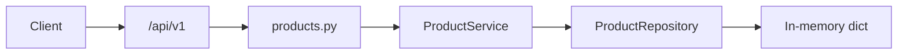

# FastAPI Product Catalog

A beginner-friendly FastAPI service: versioned routes, Pydantic schemas, repository/service layers, health checks, and interactive OpenAPI docs. Products are stored in memory (data resets when the process restarts).

## What you get

| Feature | Details |
|---------|---------|
| Root welcome | `GET /` — pointer to `/docs` |
| Health | `GET /api/v1/health` — liveness for probes |
| Catalog | CRUD on `/api/v1/products` with SKU, category, tags, and stock |
| Lookup | `GET /api/v1/products/by-sku/{sku}` — case-insensitive SKU |
| Categories | `GET /api/v1/products/categories` — active catalog categories |
| Filters | `category`, `search`, `in_stock`, `featured`, `discontinued` |
| Workflow | Feature/unfeature, discontinue/restore |
| Errors | `{"detail": "..."}` with 404 / 409 as appropriate |
| Tests | Pytest coverage for filters, SKU rules, and lifecycle |

## Seed products

| SKU | Name | Notes |
|-----|------|--------|
| `HUB-USBC-7IN1` | USB-C 7-in-1 Hub | Featured, in stock |
| `MOUSE-WIRELESS-MX` | Wireless Mouse MX | Peripherals |
| `KB-MECH-87` | Mechanical Keyboard 87-key | Out of stock, discontinued |

## Project layout

```
app/
  main.py                 # OpenAPI narrative, CORS, exception handlers
  core/                   # Settings, AppError
  api/v1/endpoints/       # products.py, health.py
  schemas/product.py      # Request/response models
  repositories/           # In-memory catalog
  services/               # Business rules
tests/api/v1/test_products.py
```

### Request flow



## Setup

```bash
python -m venv .venv
source .venv/bin/activate
pip install -e ".[dev]"
cp .env.example .env
```

## Run

```bash
uvicorn app.main:app --reload
```

| URL | Purpose |
|-----|---------|
| http://127.0.0.1:8000/docs | Swagger UI |
| http://127.0.0.1:8000/redoc | ReDoc |

## Walkthrough

```bash
curl -s http://127.0.0.1:8000/api/v1/products
curl -s http://127.0.0.1:8000/api/v1/products/by-sku/hub-usbc-7in1
curl -s -X POST http://127.0.0.1:8000/api/v1/products \
  -H "Content-Type: application/json" \
  -d '{"sku":"pad-desk-xl","name":"Desk pad XL","price":18,"category":"accessories","stock_quantity":30}'
```

Open `/docs` for the full tag descriptions and POST examples.

## API reference

| Method | Path | Description |
|--------|------|-------------|
| GET | `/api/v1/products` | List products (filters) |
| GET | `/api/v1/products/categories` | List categories |
| GET | `/api/v1/products/by-sku/{sku}` | Get by SKU |
| GET | `/api/v1/products/{id}` | Get by id |
| POST | `/api/v1/products` | Create |
| PATCH | `/api/v1/products/{id}` | Partial update |
| POST | `/api/v1/products/{id}/feature` | Mark featured |
| POST | `/api/v1/products/{id}/unfeature` | Clear featured |
| POST | `/api/v1/products/{id}/discontinue` | Discontinue |
| POST | `/api/v1/products/{id}/restore` | Restore |
| DELETE | `/api/v1/products/{id}` | Delete |

Responses include **`in_stock`** (`stock_quantity > 0`) even though it is not sent on create/update.

## Tests and lint

```bash
pytest -v
ruff check app tests
```

## Docker

```bash
docker build -t fastapi-product-catalog .
docker run --rm -p 8000:8000 fastapi-product-catalog
```
