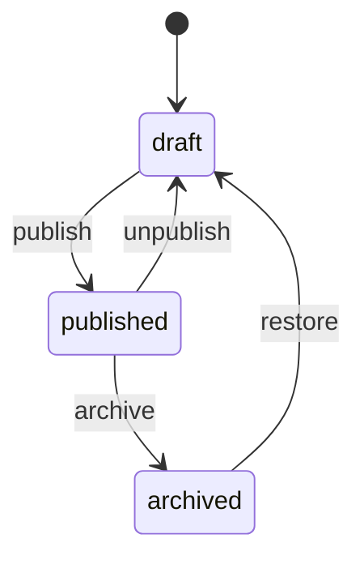
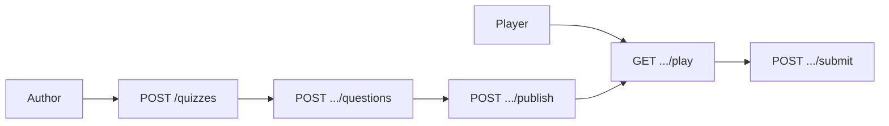

# FastAPI Quiz

A beginner-friendly FastAPI service for **multiple-choice quizzes**: draft → publish workflow, question editing, a player **play** view without answers, and **submit** scoring. Everything is in memory (data resets when the process restarts).

Interactive docs: [Swagger UI](/docs) and [ReDoc](/redoc). The OpenAPI description in `app/main.py` explains author vs player routes; create and submit bodies include runnable **Examples** in Swagger.

## What you get

| Area | Behavior |
|------|----------|
| Quizzes | Create draft, update metadata, publish / unpublish / archive / restore |
| Questions | Add while draft; patch or delete via `/api/v1/questions/{id}` |
| List | Default **published** only; `?status=draft` for work in progress |
| Play | Hides `correct_index`; unpublished quizzes return **404** |
| Submit | Score, percentage, per-question feedback (published only) |
| Errors | `{"detail": "..."}` with **404**, **409**, or **422** |

## Seed data

| Id | Title | Status | Questions |
|----|-------|--------|-------------|
| `1` | Python basics | published | 3 (all `correct_index: 1` in seed) |
| `2` | FastAPI draft | draft | none |

## Setup

```bash
cd beginner/fastapi-quiz
python -m venv .venv && source .venv/bin/activate
pip install -e ".[dev]"
cp .env.example .env
uvicorn app.main:app --reload
```

| URL | Purpose |
|-----|---------|
| http://127.0.0.1:8000/docs | Swagger UI |
| http://127.0.0.1:8000/redoc | ReDoc |

## Status workflow



Publish requires at least one question. Question edits are blocked once the quiz leaves **draft**.

## Quick try (curl)

**Play the seed quiz (no answers):**

```bash
curl -s http://127.0.0.1:8000/api/v1/quizzes/1/play | head -c 400
```

**Submit perfect score** (seed correct choice is index `1` on each question):

```bash
curl -s -X POST http://127.0.0.1:8000/api/v1/quizzes/1/submit \
  -H "Content-Type: application/json" \
  -d '{
    "participant_name": "Alex",
    "answers": [
      {"question_id": 1, "choice_index": 1},
      {"question_id": 2, "choice_index": 1},
      {"question_id": 3, "choice_index": 1}
    ]
  }'
```

**Author view** (shows answer key):

```bash
curl -s http://127.0.0.1:8000/api/v1/quizzes/1
```

## Suggested walkthrough in Swagger

1. **GET /api/v1/quizzes** — only id `1` appears.
2. **GET /api/v1/quizzes/1/play** — no `correct_index` on questions.
3. **POST /api/v1/quizzes/1/submit** — use the built-in example body.
4. **POST /api/v1/quizzes** — create a draft, then **POST .../questions**.
5. **POST .../publish** — then play and submit your new quiz.

## Layout

```
app/
  main.py                     # OpenAPI narrative and tags
  schemas/quiz.py             # Models + Swagger examples
  repositories/quiz_repository.py
  services/quiz_service.py    # Status rules and scoring
  api/v1/endpoints/           # quizzes, questions, health
tests/api/v1/test_quiz.py
```



## API reference

| Method | Path | Description |
|--------|------|-------------|
| GET | `/api/v1/health` | Liveness |
| GET | `/api/v1/quizzes` | List quizzes (`?status=draft\|published\|archived`) |
| POST | `/api/v1/quizzes` | Create draft |
| GET | `/api/v1/quizzes/{id}` | Author detail with `correct_index` |
| PATCH | `/api/v1/quizzes/{id}` | Update title / description |
| POST | `/api/v1/quizzes/{id}/publish` | Draft → published |
| POST | `/api/v1/quizzes/{id}/unpublish` | Published → draft |
| POST | `/api/v1/quizzes/{id}/archive` | Published → archived |
| POST | `/api/v1/quizzes/{id}/restore` | Archived → draft |
| GET | `/api/v1/quizzes/{id}/play` | Player view (published only) |
| POST | `/api/v1/quizzes/{id}/submit` | Score an attempt |
| POST | `/api/v1/quizzes/{id}/questions` | Add question (draft only) |
| PATCH | `/api/v1/questions/{id}` | Edit question (draft only) |
| DELETE | `/api/v1/questions/{id}` | Remove question (draft only) |

## Tests and lint

```bash
pytest -v
ruff check app tests
```

## Docker

```bash
docker build -t fastapi-quiz .
docker run --rm -p 8000:8000 fastapi-quiz
```

Replace in-memory storage before any shared deployment.
