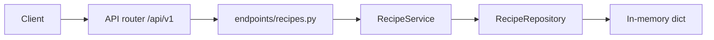

# FastAPI Recipe Box

A beginner-friendly personal recipe API. Routes live under `/api/v1`. Each request goes through an endpoint, a service, and an in-memory repository. Data resets when the process restarts.

## What you get

| Feature | Details |
|---------|---------|
| Root welcome | `GET /` — short JSON pointer to `/docs` |
| Health | `GET /api/v1/health` — liveness for probes |
| Recipes | Create, read, update, feature, unfeature, and delete on `/api/v1/recipes` |
| Cuisines | `GET /api/v1/recipes/cuisines` — distinct cuisine labels |
| Filters | `cuisine`, `search`, `featured`, `difficulty`, `vegetarian`, `max_total_minutes` |
| Validation | Title/chef length, time ranges, difficulty enum via Pydantic |
| Uniqueness | Duplicate source URLs return **409** (trailing slash ignored) |
| Errors | Missing recipes return `{"detail": "Recipe {id} not found"}` with status 404 |
| Docs | Swagger UI at `/docs` and ReDoc at `/redoc`, with request examples |
| Tests | Pytest coverage for seed data, search, URL rules, feature, delete, cuisines |

## Project layout

```
app/
  main.py                 # App factory, CORS, exception handlers, OpenAPI text
  core/                   # Settings (pydantic-settings), AppError types
  api/v1/endpoints/       # HTTP route handlers
  schemas/                # Pydantic request/response models
  repositories/           # In-memory recipe store
  services/               # Source URL uniqueness and 404 mapping
tests/
  api/v1/                 # API integration tests
```

### Request flow



## Rules

| Field | Rule |
|-------|------|
| `title` | Required. 1–200 characters after trim. |
| `chef` | Required. 1–120 characters after trim. |
| `source_url` | Optional. Unique when set. Comparison ignores trailing slashes. |
| `cuisine` | Defaults to `General`. At most 60 characters. |
| `prep_minutes` / `cook_minutes` | Optional integers from 1 through 600. |
| `total_minutes` | Read-only sum when both prep and cook are set. |
| `servings` | Defaults to 4 (1–50). |
| `difficulty` | `easy`, `medium`, or `hard` (default `easy`). |
| `vegetarian` | Defaults to `false`. |
| `featured` | Defaults to `false`. Featured recipes list first. |

## Seed data

| id | Title | Notes |
|----|-------|-------|
| 1 | Weeknight Pasta | Featured, vegetarian, 25 min total |
| 2 | Classic Chili | American, medium |
| 3 | Mushroom Risotto | Vegetarian Italian |

## Setup

```bash
python -m venv .venv
source .venv/bin/activate
pip install -e ".[dev]"
cp .env.example .env
```

## Run

```bash
uvicorn app.main:app --reload
```

| URL | Purpose |
|-----|---------|
| http://127.0.0.1:8000/docs | Swagger UI |
| http://127.0.0.1:8000/redoc | ReDoc |

## Walkthrough

```bash
curl -s http://127.0.0.1:8000/api/v1/recipes
curl -s 'http://127.0.0.1:8000/api/v1/recipes?max_total_minutes=30&vegetarian=true'

curl -s -X POST http://127.0.0.1:8000/api/v1/recipes \
  -H "Content-Type: application/json" \
  -d '{
    "title": "Sheet Pan Lemon Chicken",
    "chef": "Taylor Brooks",
    "cuisine": "Mediterranean",
    "prep_minutes": 15,
    "cook_minutes": 25,
    "difficulty": "easy"
  }'
```

Open http://127.0.0.1:8000/docs and expand **recipes** to try the bundled examples.

## API reference

| Method | Path | Description |
|--------|------|-------------|
| GET | `/api/v1/recipes/cuisines` | Distinct cuisines |
| GET | `/api/v1/recipes` | List recipes (query filters) |
| GET | `/api/v1/recipes/{id}` | Get one recipe |
| POST | `/api/v1/recipes` | Create recipe |
| PUT | `/api/v1/recipes/{id}` | Replace recipe |
| PATCH | `/api/v1/recipes/{id}` | Partial update |
| POST | `/api/v1/recipes/{id}/feature` | Mark featured |
| POST | `/api/v1/recipes/{id}/unfeature` | Clear featured |
| DELETE | `/api/v1/recipes/{id}` | Delete recipe |

## Where the rules live

| Rule | Location |
|------|----------|
| Request validation | `app/schemas/recipe.py` |
| Source URL uniqueness | `RecipeService` + `RecipeRepository.source_url_taken` |
| List ordering and filters | `RecipeRepository.list_recipes` |
| HTTP status mapping | `AppError` handler in `app/main.py` |

## Tests and lint

```bash
pytest -v
ruff check app tests
```

## Docker

```bash
docker build -t fastapi-recipes .
docker run --rm -p 8000:8000 fastapi-recipes
```
