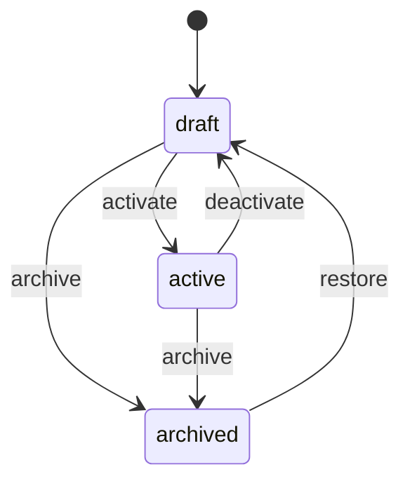
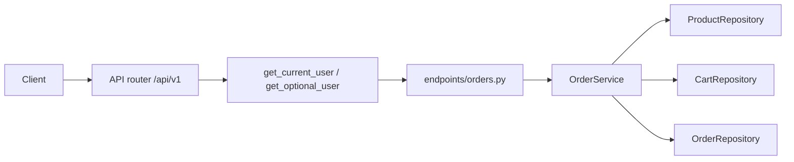

# FastAPI E-commerce

An intermediate FastAPI service: JWT login, admin-managed product catalog, per-user carts, and checkout with stock updates. Users, products, carts, and orders live in memory and reset when the process restarts.

The interesting part is where rules live. Dependencies prove **who you are**. `ProductService`, `CartService`, and `OrderService` enforce visibility, stock, and order privacy.

Interactive docs: [Swagger UI](/docs) and [ReDoc](/redoc). **PUT /api/v1/cart/lines** and **POST /api/v1/orders** include request examples.

## What you get

| Area | Behavior |
|------|----------|
| Auth | Register, login, refresh rotation, logout, `GET /api/v1/auth/me` |
| Products | Public list is **active** only. Admins create drafts, edit, activate, deactivate, archive |
| Visibility | Draft and archived products return **404** to non-admins |
| Cart | Signed-in users add lines for active products with available stock |
| Checkout | `POST /api/v1/orders` decrements stock, snapshots prices, clears the cart |
| Cancel | Buyers (or admins) cancel **placed** orders and restock inventory |
| Privacy | Another user's order id returns **404**, not **403** |
| Tags | Public tag counts from active products only |
| Errors | Domain failures return `{"detail": "..."}` with 401, 403, 404, or 409 |

## Roles

| | User | Platform admin |
|--|------|----------------|
| List active products | Yes (no token) | Yes; may filter draft/archived |
| View draft product | **404** | Yes |
| Create / edit products | No | Yes (edit drafts only) |
| Activate / deactivate / archive | No | Yes |
| Cart and checkout | Yes | Yes |
| List orders | Own rows | All rows |
| Cancel order | Own **placed** order | Any order |

## Product status



## Project layout

```
app/
  main.py                 # App factory, OpenAPI text, CORS, AppError handler
  core/                   # Settings, JWT + bcrypt, AppError types
  api/deps.py             # Bearer token, optional user, repository providers
  api/v1/endpoints/       # auth, users, products, cart, orders, tags, health
  schemas/                # Pydantic models for catalog, cart, orders
  repositories/           # In-memory products, carts, orders
  services/               # Visibility, stock, checkout rules
tests/
  api/v1/                 # Auth, catalog, cart, checkout
```

### Request flow



## Setup

```bash
python -m venv .venv
source .venv/bin/activate
pip install -e ".[dev]"
cp .env.example .env
```

## Run

```bash
uvicorn app.main:app --reload
```

| URL | Purpose |
|-----|---------|
| http://127.0.0.1:8000/docs | Swagger UI |
| http://127.0.0.1:8000/redoc | ReDoc |

Seed catalog:

| | Value |
|--|--------|
| Admin | `admin@example.com` / `AdminPass123!` |
| Active product | slug `usb-c-hub`, stock 10, $49.99 |
| Draft product | slug `draft-wireless-mouse` (404 without admin token) |

## Walkthrough

**Browse (no login)**

```bash
curl -s http://127.0.0.1:8000/api/v1/products
curl -s http://127.0.0.1:8000/api/v1/products/usb-c-hub
```

**Register and shop**

Login uses a form body. The field is `username`, and the value is the email.

```bash
curl -s -X POST http://127.0.0.1:8000/api/v1/auth/register \
  -H 'Content-Type: application/json' \
  -d '{"email":"you@example.com","password":"SecurePass1!","full_name":"You"}'

USER_TOKEN=$(curl -s -X POST http://127.0.0.1:8000/api/v1/auth/login \
  -d 'username=you@example.com&password=SecurePass1!' | jq -r .access_token)

curl -s -X PUT http://127.0.0.1:8000/api/v1/cart/lines \
  -H "Authorization: Bearer $USER_TOKEN" \
  -H 'Content-Type: application/json' \
  -d '{"product_slug":"usb-c-hub","quantity":2}'

curl -s -X POST http://127.0.0.1:8000/api/v1/orders \
  -H "Authorization: Bearer $USER_TOKEN" \
  -H 'Content-Type: application/json' \
  -d '{"note":"Gift wrap please"}'
```

**Admin: create and activate a listing**

```bash
ADMIN_TOKEN=$(curl -s -X POST http://127.0.0.1:8000/api/v1/auth/login \
  -d 'username=admin@example.com&password=AdminPass123!' | jq -r .access_token)

curl -s -X POST http://127.0.0.1:8000/api/v1/products \
  -H "Authorization: Bearer $ADMIN_TOKEN" \
  -H 'Content-Type: application/json' \
  -d '{"name":"Desk Lamp","price_cents":4599,"stock":8}'

curl -s -X POST http://127.0.0.1:8000/api/v1/products/desk-lamp/activate \
  -H "Authorization: Bearer $ADMIN_TOKEN"
```

## Where the rules live

| Rule | Location |
|------|----------|
| Draft/archived visibility | `can_view_product` in `app/services/product_service.py` |
| Activate / deactivate / archive | `ProductService.transition` |
| Cart stock checks | `CartService.upsert_line` |
| Checkout and restock | `OrderService.checkout`, `OrderService.cancel` |
| Order privacy | `OrderService._can_view` |

## API reference

| Method | Path | Who | Description |
|--------|------|-----|-------------|
| GET | `/api/v1/products` | Public (+ optional bearer) | Active products; admin may filter `status` |
| GET | `/api/v1/products/{slug}` | Public (+ optional bearer) | One product; hidden rows are 404 |
| POST | `/api/v1/products` | Admin | Create draft |
| PATCH | `/api/v1/products/{slug}` | Admin | Edit draft |
| POST | `/api/v1/products/{slug}/activate` | Admin | `draft` → `active` |
| POST | `/api/v1/products/{slug}/deactivate` | Admin | `active` → `draft` |
| POST | `/api/v1/products/{slug}/archive` | Admin | Archive |
| POST | `/api/v1/products/{slug}/restore` | Admin | `archived` → `draft` |
| GET | `/api/v1/cart` | Bearer | View cart |
| PUT | `/api/v1/cart/lines` | Bearer | Add or update a line |
| DELETE | `/api/v1/cart/lines/{product_slug}` | Bearer | Remove line |
| DELETE | `/api/v1/cart` | Bearer | Clear cart |
| GET | `/api/v1/orders` | Bearer | List orders |
| GET | `/api/v1/orders/{id}` | Bearer | One order (404 for other users) |
| POST | `/api/v1/orders` | Bearer | Checkout |
| POST | `/api/v1/orders/{id}/cancel` | Buyer or admin | Cancel and restock |
| GET | `/api/v1/tags` | — | Tags on active products |

## Tests

```bash
pytest -v
ruff check app tests
```

## Docker

```bash
docker build -t fastapi-ecommerce .
docker run --rm -p 8000:8000 -e SECRET_KEY=your-production-secret fastapi-ecommerce
```

## What this store is not

Data lives in process memory. A restart drops carts and orders except the seeded products and admin user. For production you would persist catalog, carts, and orders in a database and add payment capture — the service layer is where stock and visibility rules would stay.
