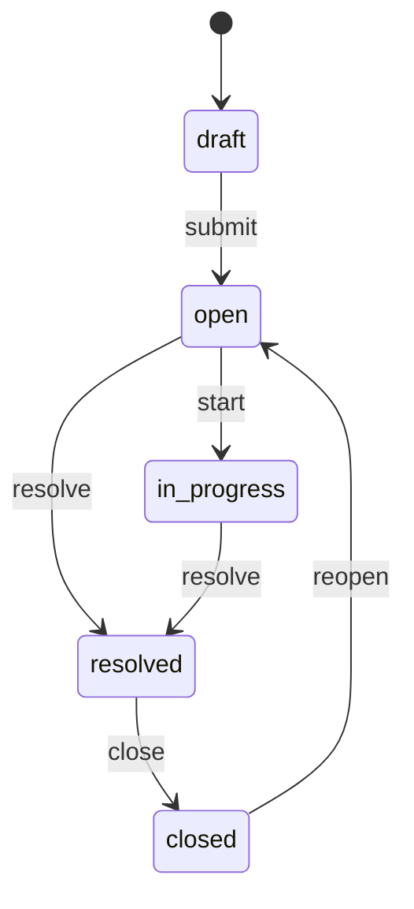

# FastAPI Helpdesk

An intermediate FastAPI service: JWT login, **support tickets** with a status workflow, **replies**, and **category** counts. Users, tickets, and replies live in memory and reset when the process restarts.

`TicketService` and `ReplyService` enforce who can see a ticket, legal status moves, assignment, and when the thread accepts new messages.

Interactive docs: [Swagger UI](/docs) and [ReDoc](/redoc). **POST /api/v1/tickets** includes create examples.

## What you get

| Area | Behavior |
|------|----------|
| Auth | Register, login, refresh rotation, logout, `GET /api/v1/auth/me` |
| Tickets | Create **draft**, **submit** to open, priority and tags |
| Queue | Admins list the queue with filters; users list **mine** or **assigned** |
| Visibility | Requester, assignee, or admin; others get **404** |
| Workflow | Dedicated routes: submit, start, resolve, close, reopen |
| Replies | Thread on open / in_progress / resolved tickets |
| Categories | `GET /api/v1/categories` — tag counts on submitted tickets |

## Roles

| | Customer (user) | Assignee | Admin |
|--|-----------------|----------|-------|
| Create draft | Yes | Yes | Yes |
| Submit / edit content | Own tickets | No | No |
| View ticket | Own + assigned | Assigned | Any |
| Start / resolve | No | Assigned or admin | Yes |
| Close | Own ticket | No | Yes |
| Assign agent | No | No | Yes (`PATCH assignee_id`) |
| Support queue | No | No | Yes |

## Ticket status



## Project layout

```
app/
  main.py
  core/
  api/deps.py
  api/v1/endpoints/   # auth, users, tickets, replies, categories, health
  schemas/ticket.py
  repositories/
  services/
tests/api/v1/
```

## Setup

```bash
python -m venv .venv
source .venv/bin/activate
pip install -e ".[dev]"
cp .env.example .env
```

## Run

```bash
uvicorn app.main:app --reload
```

| | Value |
|--|--------|
| Admin | `admin@example.com` / `AdminPass123!` |
| Open ticket | `cannot-reset-password` |
| Draft | `draft-vpn-request` |

## Walkthrough

```bash
TOKEN=$(curl -s -X POST http://127.0.0.1:8000/api/v1/auth/login \
  -d "username=admin@example.com&password=AdminPass123!" | jq -r .access_token)

curl -s http://127.0.0.1:8000/api/v1/tickets -H "Authorization: Bearer $TOKEN"
curl -s http://127.0.0.1:8000/api/v1/tickets/cannot-reset-password/replies \
  -H "Authorization: Bearer $TOKEN"
```

## Tests

```bash
pytest -v
ruff check app tests
```
