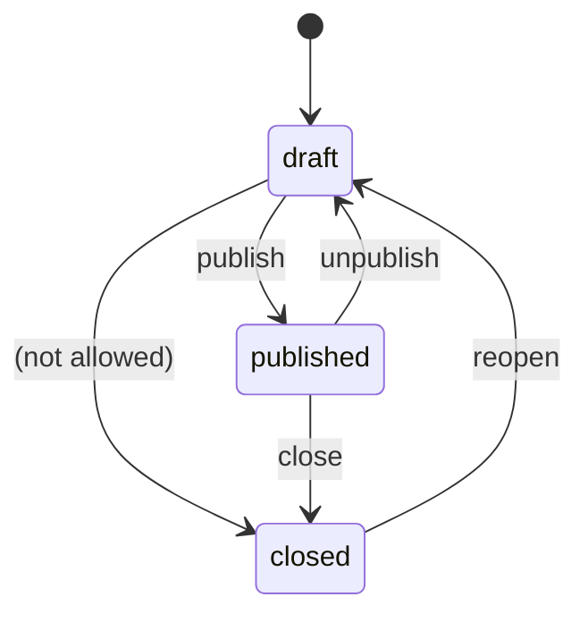
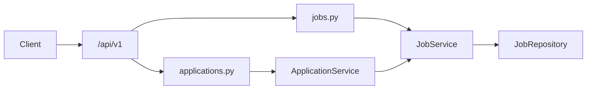

# FastAPI Job Board

An intermediate FastAPI service: JWT login, **job postings** with a publish workflow, **applications**, and a public **skills** facet. Users, jobs, and applications live in memory and reset when the process restarts.

Dependencies prove **who you are**. `JobService` and `ApplicationService` enforce board visibility, status transitions, and who may review applicants.

Interactive docs: [Swagger UI](/docs) and [ReDoc](/redoc). **POST /api/v1/jobs** includes create examples.

## What you get

| Area | Behavior |
|------|----------|
| Auth | Register, login, refresh rotation, logout, `GET /api/v1/auth/me` |
| Board | Public list is **published** jobs only |
| Visibility | Draft/closed jobs return **404** to guests (not **403**) |
| Posting | Signed-in users create **drafts**, then publish |
| Apply | Candidates apply to published jobs; not to their own posting |
| Review | Employers list applications on jobs they own; admins see all |
| Skills | `GET /api/v1/skills` counts skills on published jobs |
| Errors | Domain failures return `{"detail": "..."}` with 401, 403, 404, or 409 |

## Roles

| | Candidate (user) | Employer (user) | Platform admin |
|--|------------------|-----------------|----------------|
| Browse published jobs | Yes (no token) | Yes | Yes |
| View draft/closed job | **404** | Own postings | Any |
| Create / edit jobs | Yes (own drafts) | Yes | Read/close/delete only |
| Publish / unpublish | Own jobs | Own jobs | No |
| Close published job | No | Yes | Yes |
| Apply | Yes | Yes (not own job) | Yes |
| List applications | No | Own jobs | Any job |
| List all users | No | No | Yes |

## Job status



## Project layout

```
app/
  main.py                 # App factory, OpenAPI narrative, CORS, AppError handler
  core/                   # Settings, JWT + bcrypt, AppError types
  api/deps.py             # Bearer token, optional user, repository providers
  api/v1/endpoints/       # auth, users, jobs, applications, skills, health
  schemas/job.py          # Jobs, skills, work mode, employment type
  repositories/           # In-memory jobs and applications
  services/               # Visibility, publish/close rules, apply logic
tests/
  api/v1/                 # Auth, jobs, applications
```

### Request flow



## Setup

```bash
python -m venv .venv
source .venv/bin/activate
pip install -e ".[dev]"
cp .env.example .env
```

## Run

```bash
uvicorn app.main:app --reload
```

| URL | Purpose |
|-----|---------|
| http://127.0.0.1:8000/docs | Swagger UI |
| http://127.0.0.1:8000/redoc | ReDoc |

Seed data:

| | Value |
|--|--------|
| Admin / employer seed | `admin@example.com` / `AdminPass123!` |
| Published job | `senior-fastapi-engineer` |
| Draft job | `draft-frontend-contract` (404 without token) |

## Walkthrough

**Browse the board (no login)**

```bash
curl -s http://127.0.0.1:8000/api/v1/jobs
curl -s http://127.0.0.1:8000/api/v1/jobs/senior-fastapi-engineer
curl -s http://127.0.0.1:8000/api/v1/skills
```

**Register and post a draft**

```bash
curl -s -X POST http://127.0.0.1:8000/api/v1/auth/register \
  -H "Content-Type: application/json" \
  -d '{"email":"hire@example.com","password":"SecurePass1!","full_name":"Hiring Manager"}'

TOKEN=$(curl -s -X POST http://127.0.0.1:8000/api/v1/auth/login \
  -d "username=hire@example.com&password=SecurePass1!" | jq -r .access_token)

curl -s -X POST http://127.0.0.1:8000/api/v1/jobs \
  -H "Authorization: Bearer $TOKEN" \
  -H "Content-Type: application/json" \
  -d '{"title":"Backend engineer","company":"Acme Labs","description":"Ship REST APIs.","skills":["python"]}'
```

**Publish, apply, review**

```bash
curl -s -X POST http://127.0.0.1:8000/api/v1/jobs/backend-engineer/publish \
  -H "Authorization: Bearer $TOKEN"

curl -s -X POST http://127.0.0.1:8000/api/v1/jobs/backend-engineer/applications \
  -H "Authorization: Bearer $CANDIDATE_TOKEN" \
  -H "Content-Type: application/json" \
  -d '{"cover_letter":"Three years of FastAPI."}'

curl -s http://127.0.0.1:8000/api/v1/jobs/backend-engineer/applications \
  -H "Authorization: Bearer $TOKEN"
```

## Tests

```bash
pytest -v
ruff check app tests
```
