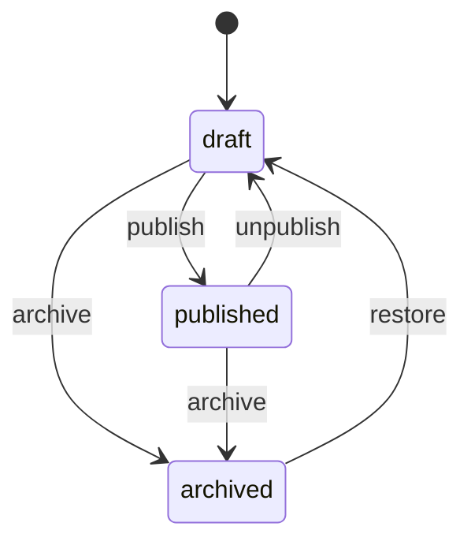

# FastAPI Learning Platform

An intermediate FastAPI service: JWT login, a public **course catalog**, **lessons**, **enrollments**, and **progress**. Users, courses, and enrollments live in memory and reset when the process restarts.

Dependencies prove **who you are**. `CourseService` and `EnrollmentService` enforce catalog visibility, lesson content gates, and enrollment privacy.

Interactive docs: [Swagger UI](/docs) and [ReDoc](/redoc). **POST /api/v1/enrollments** includes an enroll example.

## What you get

| Area | Behavior |
|------|----------|
| Auth | Register, login, refresh rotation, logout, `GET /api/v1/auth/me` |
| Catalog | Public list is **published** courses only |
| Visibility | Draft/archived courses and draft lessons return **404** to guests |
| Lessons | Titles public; **body** empty until enrolled (admins always see body) |
| Enroll | Signed-in users join **published** courses |
| Progress | Mark lessons complete; auto-**completed** when all published lessons done |
| Privacy | Another user's enrollment id returns **404**, not **403** |
| Errors | Domain failures return `{"detail": "..."}` with 401, 403, 404, or 409 |

## Roles

| | Student (user) | Instructor admin |
|--|----------------|------------------|
| Browse published courses | Yes (no token) | Yes; filter drafts |
| View draft course | **404** | Yes |
| Create / edit courses & lessons | No | Yes (edit drafts only) |
| Publish / archive | No | Yes |
| Enroll | Yes | Yes |
| Complete lessons | Own enrollment | Own enrollment |
| List enrollments | Own rows | All rows |

## Course status



Lessons use `draft` / `published` with separate publish routes under each course.

## Project layout

```
app/
  main.py                 # App factory, OpenAPI text, CORS, AppError handler
  core/                   # Settings, JWT + bcrypt, AppError types
  api/deps.py             # Bearer token, optional user, repository providers
  api/v1/endpoints/       # auth, users, courses, enrollments, health
  schemas/course.py       # Courses, lessons, enrollments
  repositories/           # In-memory courses, lessons, enrollments
  services/               # Visibility, progress, publish rules
tests/
  api/v1/                 # Auth, courses, enrollments
```

## Setup

```bash
python -m venv .venv
source .venv/bin/activate
pip install -e ".[dev]"
cp .env.example .env
```

## Run

```bash
uvicorn app.main:app --reload
```

| URL | Purpose |
|-----|---------|
| http://127.0.0.1:8000/docs | Swagger UI |
| http://127.0.0.1:8000/redoc | ReDoc |

Seed data:

| | Value |
|--|--------|
| Admin | `admin@example.com` / `AdminPass123!` |
| Published course | `fastapi-fundamentals` (2 published lessons) |
| Draft course | `draft-async-deep-dive` (404 without admin) |

## Walkthrough

**Browse the catalog (no login)**

```bash
curl -s http://127.0.0.1:8000/api/v1/courses
curl -s http://127.0.0.1:8000/api/v1/courses/fastapi-fundamentals/lessons
```

Lesson bodies are empty strings until you enroll.

**Register, enroll, and complete a lesson**

```bash
curl -s -X POST http://127.0.0.1:8000/api/v1/auth/register \
  -H 'Content-Type: application/json' \
  -d '{"email":"you@example.com","password":"SecurePass1!","full_name":"You"}'

TOKEN=$(curl -s -X POST http://127.0.0.1:8000/api/v1/auth/login \
  -d 'username=you@example.com&password=SecurePass1!' | jq -r .access_token)

curl -s -X POST http://127.0.0.1:8000/api/v1/enrollments \
  -H "Authorization: Bearer $TOKEN" \
  -H 'Content-Type: application/json' \
  -d '{"course_slug":"fastapi-fundamentals"}'

curl -s -X POST http://127.0.0.1:8000/api/v1/enrollments/1/lessons/welcome/complete \
  -H "Authorization: Bearer $TOKEN"
```

## API reference

| Method | Path | Who | Description |
|--------|------|-----|-------------|
| GET | `/api/v1/courses` | Public (+ optional bearer) | Published courses |
| GET | `/api/v1/courses/{slug}` | Public (+ optional bearer) | One course |
| POST | `/api/v1/courses` | Admin | Create draft course |
| PATCH | `/api/v1/courses/{slug}` | Admin | Edit draft |
| POST | `/api/v1/courses/{slug}/publish` | Admin | Publish |
| GET | `/api/v1/courses/{slug}/lessons` | Public (+ optional bearer) | Lesson list |
| POST | `/api/v1/courses/{slug}/lessons/{lesson}/publish` | Admin | Publish lesson |
| GET | `/api/v1/enrollments` | Bearer | List enrollments |
| POST | `/api/v1/enrollments` | Bearer | Enroll |
| POST | `/api/v1/enrollments/{id}/lessons/{slug}/complete` | Bearer | Mark complete |
| POST | `/api/v1/enrollments/{id}/drop` | Bearer | Drop active enrollment |

## Where the rules live

| Rule | Location |
|------|----------|
| Draft course visibility | `can_view_course` in `app/services/course_service.py` |
| Lesson body gate | `can_read_lesson_body` in the same module |
| Progress / completion | `EnrollmentService.complete_lesson` |
| Enrollment privacy | `EnrollmentService._can_view` |

## Tests and lint

```bash
pytest -v
ruff check app tests
```

## Docker

```bash
docker build -t fastapi-learning .
docker run --rm -p 8000:8000 -e SECRET_KEY=your-production-secret fastapi-learning
```

## What this demo is not

There is no video hosting, quizzes, or payments. A production LMS would persist media, grade attempts, and issue certificates — the **service layer** here is where those rules would grow.
