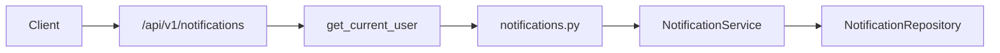

# FastAPI Notifications

An intermediate FastAPI service: JWT login, a **personal notification inbox**, read/unread state, delivery **preferences**, and **admin dispatch**. Users, tokens, and notifications live in memory and reset when the process restarts.

Ownership rules live in `NotificationService`, not in the route handlers. Another user's notification id returns **404** so you cannot probe foreign inboxes.

Interactive docs: [Swagger UI](/docs) and [ReDoc](/redoc).

## What you get

| Area | Behavior |
|------|----------|
| Auth | Register, login, refresh rotation, logout, `GET /api/v1/auth/me` |
| Inbox | Paginated list, newest first, optional `unread_only` filter |
| Unread | Badge count endpoint and mark-one / mark-all read |
| Preferences | Per-user email/push toggles (demo store) |
| Dispatch | Platform admin sends a notification to any user id |
| Errors | `AppError` → `{"detail": "..."}` with 401, 403, 404, or 409 |

## Status codes (on purpose)

| Status | When | Example |
|--------|------|---------|
| 401 | Missing or invalid bearer on a protected route | `GET /notifications` without token |
| 403 | Authenticated but not allowed | Non-admin calls `POST /notifications/dispatch` |
| 404 | Notification missing **or** not yours | User B opens user A's notification id |
| 409 | Rule violation with a visible resource | Mark-read twice on the same row |

## Layout

```
app/
  main.py                      # OpenAPI narrative and tags
  api/deps.py                  # JWT user + repository providers
  api/v1/endpoints/            # auth, users, notifications, health
  schemas/notification.py      # inbox models, dispatch, preferences
  repositories/                # in-memory users, tokens, notifications
  services/notification_service.py
tests/api/v1/test_notifications.py
```



## Setup

```bash
cd intermediate/fastapi-notifications
python -m venv .venv && source .venv/bin/activate
pip install -e ".[dev]"
cp .env.example .env
uvicorn app.main:app --reload
```

| URL | Purpose |
|-----|---------|
| http://127.0.0.1:8000/docs | Swagger UI |
| http://127.0.0.1:8000/redoc | ReDoc |

### Seed accounts

| Email | Password | Inbox |
|-------|----------|--------|
| `admin@example.com` | `AdminPass123!` | 3 items (2 unread) |
| `demo@example.com` | `DemoPass123!` | 1 unread welcome |

## Walkthrough

**1. Log in and list**

Login uses form fields (`username` = email):

```bash
curl -s -X POST http://127.0.0.1:8000/api/v1/auth/login \
  -d "username=admin@example.com&password=AdminPass123!"
```

```bash
curl -s http://127.0.0.1:8000/api/v1/notifications/unread-count \
  -H "Authorization: Bearer <access_token>"

curl -s "http://127.0.0.1:8000/api/v1/notifications?unread_only=true" \
  -H "Authorization: Bearer <access_token>"
```

**2. Mark read**

```bash
curl -s -X POST http://127.0.0.1:8000/api/v1/notifications/1/read \
  -H "Authorization: Bearer <access_token>"
```

**3. Admin dispatch**

```bash
curl -s -X POST http://127.0.0.1:8000/api/v1/notifications/dispatch \
  -H "Authorization: Bearer <admin_access_token>" \
  -H "Content-Type: application/json" \
  -d '{"user_id":2,"type":"system","title":"Hello","body":"From admin."}'
```

**4. Preferences**

```bash
curl -s -X PATCH http://127.0.0.1:8000/api/v1/notifications/preferences \
  -H "Authorization: Bearer <access_token>" \
  -H "Content-Type: application/json" \
  -d '{"push_enabled":false}'
```

In Swagger, use **Authorize** with an access token from login before inbox routes.

## API reference

| Method | Path | Who | Description |
|--------|------|-----|-------------|
| GET | `/api/v1/notifications` | Bearer | Inbox page. Query: `unread_only`, `limit`, `offset` |
| GET | `/api/v1/notifications/unread-count` | Bearer | Unread badge count |
| POST | `/api/v1/notifications/read-all` | Bearer | Mark all read |
| GET | `/api/v1/notifications/preferences` | Bearer | Read toggles |
| PATCH | `/api/v1/notifications/preferences` | Bearer | Update toggles |
| POST | `/api/v1/notifications/dispatch` | Admin | Enqueue for `user_id` |
| GET | `/api/v1/notifications/{id}` | Bearer | One row (404 if not yours) |
| POST | `/api/v1/notifications/{id}/read` | Bearer | Set `read_at` |
| DELETE | `/api/v1/notifications/{id}` | Bearer | Dismiss (`204`) |

Auth and user routes match the other intermediate JWT samples (`/auth/*`, `/users` for admin).

## Tests and lint

```bash
pytest -v
ruff check app tests
```

## Docker

```bash
docker build -t fastapi-notifications .
docker run --rm -p 8000:8000 -e SECRET_KEY=your-production-secret fastapi-notifications
```

Replace in-memory stores and rotate `SECRET_KEY` before any shared deployment.
