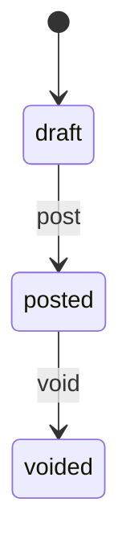

# FastAPI Personal Finance

An intermediate FastAPI service: JWT login, **accounts** with computed balances, **transactions** with a draft/post/void workflow, and **spending** totals by category. Data lives in memory and resets when the process restarts.

`AccountService` and `TransactionService` enforce ownership (404 for strangers), balance rules, and legal status transitions.

Interactive docs: [Swagger UI](/docs) and [ReDoc](/redoc). **POST /api/v1/accounts** and transaction create include examples.

## What you get

| Area | Behavior |
|------|----------|
| Auth | Register, login, refresh rotation, logout, `GET /api/v1/auth/me` |
| Accounts | Checking, savings, credit card; slug lookup; archive/restore |
| Balances | `current_balance` = opening + sum of **posted** amounts |
| Transactions | Create **draft**, **post**, **void**; edit drafts only |
| Privacy | Owner or admin; others get **404** on accounts and transactions |
| Spending | `GET /api/v1/spending/categories` — posted expenses by category |
| Admin | `GET /api/v1/accounts` lists every account |

## Transaction status



Draft and voided rows do not change **current_balance**.

## Project layout

```
app/
  main.py
  core/
  api/deps.py
  api/v1/endpoints/   # auth, users, accounts, transactions, spending, health
  schemas/finance.py
  repositories/
  services/
tests/api/v1/
```

## Setup

```bash
python -m venv .venv
source .venv/bin/activate
pip install -e ".[dev]"
cp .env.example .env
```

## Run

```bash
uvicorn app.main:app --reload
```

| | Value |
|--|--------|
| Admin | `admin@example.com` / `AdminPass123!` |
| Checking | `checking-main` (seed posted groceries + salary) |
| Savings | `savings-emergency` |
| Draft on checking | Cafe expense (not in balance) |

## Walkthrough

```bash
TOKEN=$(curl -s -X POST http://127.0.0.1:8000/api/v1/auth/login \
  -d "username=admin@example.com&password=AdminPass123!" | jq -r .access_token)

curl -s http://127.0.0.1:8000/api/v1/accounts/mine -H "Authorization: Bearer $TOKEN"
curl -s http://127.0.0.1:8000/api/v1/accounts/checking-main/transactions \
  -H "Authorization: Bearer $TOKEN"
curl -s http://127.0.0.1:8000/api/v1/spending/categories -H "Authorization: Bearer $TOKEN"
```

## Tests and lint

```bash
pytest -v
ruff check app tests
```
