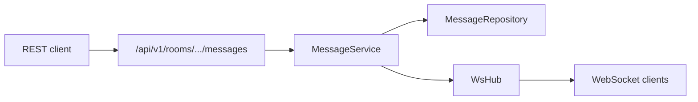

# FastAPI Realtime Chat

An intermediate FastAPI service: JWT login, **chat rooms**, **REST message history**, and **WebSocket push** when someone sends. Rooms, memberships, and messages live in memory and reset when the process restarts.

The teaching split is deliberate: HTTP handles auth, discovery, joins, and durable sends; the WebSocket only streams new messages to connected members.

Interactive docs: [Swagger UI](/docs) and [ReDoc](/redoc). OpenAPI text in `app/main.py` explains tokens on WebSockets.

## What you get

| Area | Behavior |
|------|----------|
| Auth | Register, login, refresh rotation, logout, `GET /api/v1/auth/me` |
| Discovery | `GET /api/v1/rooms` — active **public** rooms |
| Rooms | Create, metadata, join (public), invite (private), archive |
| Privacy | Private rooms **404** for non-members |
| Messages | `after_sequence` history + `POST` send |
| Realtime | `WS /api/v1/ws/rooms/{slug}?access_token=...` broadcasts sends |
| Read cursors | Per-member `last_read_sequence` |
| Errors | `{"detail": "..."}` with 401, 403, 404, 409 |

## Quick start

```bash
cd intermediate/fastapi-realtime-chat
python -m venv .venv && source .venv/bin/activate
pip install -e ".[dev]"
uvicorn app.main:app --reload
```

Seed admin: `admin@example.com` / `AdminPass123!`. Public room: `general`.

### Try realtime

1. Login and copy `access_token`.
2. `POST /api/v1/rooms/general/join` with bearer auth.
3. Connect a WebSocket client:

```bash
wscat -c "ws://127.0.0.1:8000/api/v1/ws/rooms/general?access_token=YOUR_TOKEN"
```

4. `POST /api/v1/rooms/general/messages` with JSON `{"body":"hi"}` — the socket receives `{"type":"message","payload":{...}}`.

## Suggested walkthrough (Swagger)

1. Register a user and authorize with OAuth2 (login form).
2. List rooms → join `general`.
3. Fetch messages with `after_sequence=0`.
4. Send a message and note the new `sequence`.
5. Open a WebSocket with the query token (outside Swagger) and send again.

## Project layout

```
app/
  main.py                 # OpenAPI narrative
  api/v1/endpoints/       # auth, users, rooms, messages, ws
  schemas/chat.py         # rooms, messages, ws event shape
  repositories/           # in-memory rooms + messages
  services/               # room rules, send + broadcast
  services/ws_hub.py      # in-process fan-out
tests/api/v1/test_chat_flow.py
```



## Tests

```bash
pytest -v
ruff check app tests
```
