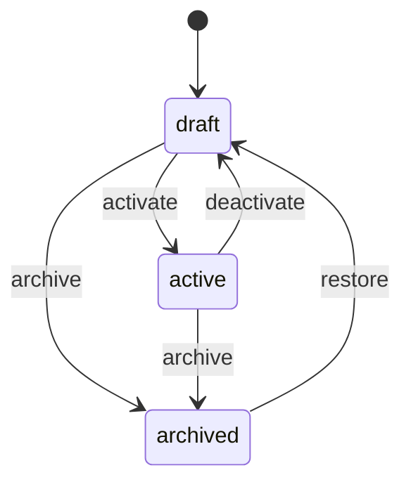
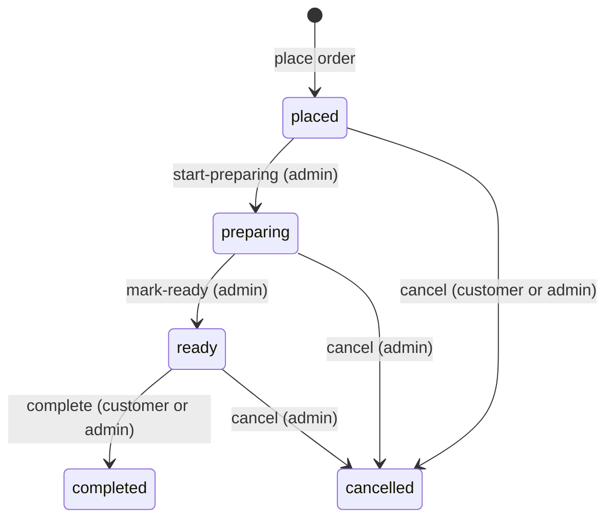
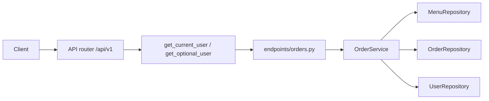

# FastAPI Restaurant Orders

An intermediate FastAPI service: JWT login, a public menu, kitchen-managed items, and customer orders with an explicit prep workflow. Users, menu rows, and orders live in memory and reset when the process restarts.

Dependencies prove **who you are**. `MenuService` and `OrderService` enforce visibility, sold-out rules, line-item price snapshots, and order privacy.

Interactive docs: [Swagger UI](/docs) and [ReDoc](/redoc). **POST /api/v1/orders** includes a place-order example.

## What you get

| Area | Behavior |
|------|----------|
| Auth | Register, login, refresh rotation, logout, `GET /api/v1/auth/me` |
| Menu | Public list is **active** and **available** only. Admins create drafts, edit, activate, archive, sold-out |
| Visibility | Draft items and sold-out active items return **404** to guests (admins can preview drafts) |
| Orders | Signed-in customers place orders with menu slugs and quantities |
| Snapshots | Each line stores name, slug, and `unit_price_cents` at order time |
| Kitchen flow | `placed` → `preparing` → `ready` → `completed`, or **cancelled** |
| Cancel | Customers cancel while **placed**. After prep starts, only kitchen staff cancel |
| Privacy | Another customer's order id returns **404**, not **403** |
| Categories | `GET /api/v1/menu/categories` from the same visibility rules as the public menu |
| Errors | Domain failures return `{"detail": "..."}` with 401, 403, 404, or 409 |

## Roles

| | Customer (user) | Kitchen staff (admin) |
|--|-----------------|------------------------|
| Browse active menu | Yes (no token) | Yes; may filter drafts / sold-out |
| View draft item | **404** | Yes |
| Create / edit menu | No | Yes (edit drafts only) |
| Activate / archive / sold-out | No | Yes |
| Place order | Yes | Yes |
| List orders | Own rows | All rows |
| Advance prep (`preparing`, `ready`) | No | Yes |
| Complete when **ready** | Own order | Any order |
| Cancel | Own order while **placed** | Any order |

## Menu item status



Sold-out is not a status. Admins toggle `available` on **active** items with `POST .../sold-out` and `POST .../restock`.

## Order status



Each arrow is its own route so the legal move is visible in `/docs`. Read `_TRANSITIONS` in `app/services/order_service.py`.

## Project layout

```
app/
  main.py                 # App factory, OpenAPI text, CORS, AppError handler
  core/                   # Settings, JWT + bcrypt, AppError types
  api/deps.py             # Bearer token, optional user, repository providers
  api/v1/endpoints/       # auth, users, menu, orders, health
  schemas/                # Pydantic models for menu and orders
  repositories/           # In-memory menu and orders
  services/               # Visibility, lifecycle, kitchen workflow
tests/
  api/v1/                 # Auth, menu, orders
```

### Request flow



## Setup

```bash
python -m venv .venv
source .venv/bin/activate
pip install -e ".[dev]"
cp .env.example .env
```

## Run

```bash
uvicorn app.main:app --reload
```

| URL | Purpose |
|-----|---------|
| http://127.0.0.1:8000/docs | Swagger UI |
| http://127.0.0.1:8000/redoc | ReDoc |

Seed data:

| | Value |
|--|--------|
| Admin | `admin@example.com` / `AdminPass123!` |
| Active menu | `classic-burger` ($12.99), `fries` ($4.99) |
| Draft item | `draft-seasonal-soup` (404 without admin token) |

## Walkthrough

**Browse the menu (no login)**

```bash
curl -s http://127.0.0.1:8000/api/v1/menu
curl -s http://127.0.0.1:8000/api/v1/menu/classic-burger
curl -s -o /dev/null -w "%{http_code}\n" \
  http://127.0.0.1:8000/api/v1/menu/draft-seasonal-soup
```

The last command prints `404`. The draft exists; guests are not told that.

**Register and place an order**

Login uses a form body. The field is `username`, and the value is the email.

```bash
curl -s -X POST http://127.0.0.1:8000/api/v1/auth/register \
  -H 'Content-Type: application/json' \
  -d '{"email":"you@example.com","password":"SecurePass1!","full_name":"You"}'

TOKEN=$(curl -s -X POST http://127.0.0.1:8000/api/v1/auth/login \
  -d 'username=you@example.com&password=SecurePass1!' | jq -r .access_token)

curl -s -X POST http://127.0.0.1:8000/api/v1/orders \
  -H "Authorization: Bearer $TOKEN" \
  -H 'Content-Type: application/json' \
  -d '{"lines":[{"menu_item_slug":"classic-burger","quantity":1},{"menu_item_slug":"fries","quantity":2}],"note":"No onions"}'
```

**Kitchen advances the order (admin)**

```bash
ADMIN=$(curl -s -X POST http://127.0.0.1:8000/api/v1/auth/login \
  -d 'username=admin@example.com&password=AdminPass123!' | jq -r .access_token)

curl -s -X POST http://127.0.0.1:8000/api/v1/orders/1/start-preparing \
  -H "Authorization: Bearer $ADMIN"
curl -s -X POST http://127.0.0.1:8000/api/v1/orders/1/mark-ready \
  -H "Authorization: Bearer $ADMIN"
curl -s -X POST http://127.0.0.1:8000/api/v1/orders/1/complete \
  -H "Authorization: Bearer $TOKEN"
```

## API reference

| Method | Path | Who | Description |
|--------|------|-----|-------------|
| GET | `/api/v1/menu` | Public (+ optional bearer) | Active, available items; admin may filter |
| GET | `/api/v1/menu/categories` | Public (+ optional bearer) | Categories from visible items |
| GET | `/api/v1/menu/{slug}` | Public (+ optional bearer) | One item; hidden rows are 404 |
| POST | `/api/v1/menu` | Admin | Create draft |
| PATCH | `/api/v1/menu/{slug}` | Admin | Edit draft |
| POST | `/api/v1/menu/{slug}/activate` | Admin | `draft` → `active` |
| POST | `/api/v1/menu/{slug}/deactivate` | Admin | `active` → `draft` |
| POST | `/api/v1/menu/{slug}/archive` | Admin | Archive |
| POST | `/api/v1/menu/{slug}/sold-out` | Admin | Mark active item unavailable |
| POST | `/api/v1/menu/{slug}/restock` | Admin | Mark active item available again |
| GET | `/api/v1/orders` | Bearer | List orders (own or all for admin) |
| GET | `/api/v1/orders/{id}` | Bearer | One order (404 for others) |
| POST | `/api/v1/orders` | Bearer | Place order |
| POST | `/api/v1/orders/{id}/cancel` | Bearer | Cancel (rules above) |
| POST | `/api/v1/orders/{id}/start-preparing` | Admin | `placed` → `preparing` |
| POST | `/api/v1/orders/{id}/mark-ready` | Admin | `preparing` → `ready` |
| POST | `/api/v1/orders/{id}/complete` | Bearer | `ready` → `completed` |

## Where the rules live

| Rule | Location |
|------|----------|
| Draft / sold-out visibility | `can_view_menu_item`, `visible_record` in `app/services/menu_service.py` |
| Orderable slugs at checkout | `MenuService.orderable_record` |
| Status graph | `_TRANSITIONS` in `app/services/order_service.py` |
| Order privacy | `OrderService._can_view` |
| Who can cancel | `OrderService.cancel` |

Read the service before the route files. Routes describe the HTTP contract; services hold the business rules.

## Tests and lint

```bash
pytest -v
ruff check app tests
```

## Docker

```bash
docker build -t fastapi-restaurant-orders .
docker run --rm -p 8000:8000 -e SECRET_KEY=your-production-secret fastapi-restaurant-orders
```

## What this demo is not

There is no payment capture, delivery tracking, or inventory counts. A production restaurant stack would persist menu and orders in a database, integrate POS payments, and likely use queues for kitchen tickets — the **service layer** here is where those rules would grow.
