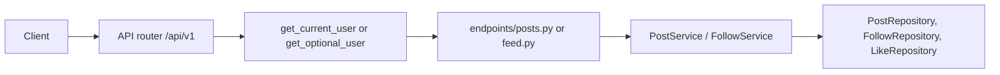
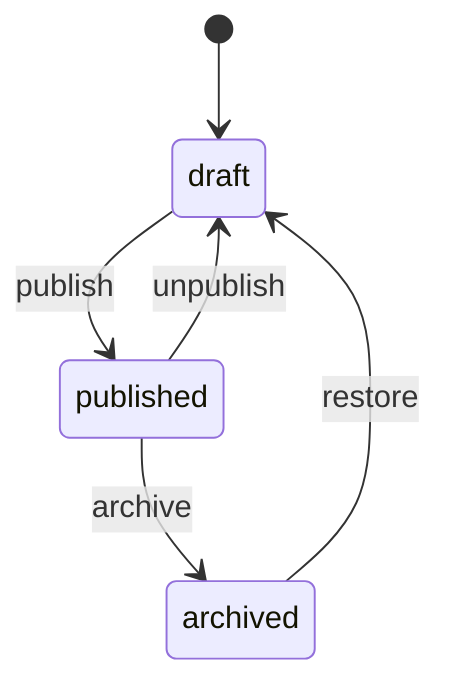

# FastAPI Social Feed

An intermediate FastAPI service: JWT login, a public **explore** list, a signed-in **home feed**, follows, likes, and a small publishing workflow. Users, refresh tokens, posts, comments, follows, and likes live in memory and reset when the process restarts.

The interesting part is visibility. A **public** published post is readable without a token. A **followers-only** published post looks like a missing slug until you follow the author (or you are the author or a platform admin). Drafts use the same **404** privacy as before — not a 403 that confirms the slug exists.

Interactive docs: [Swagger UI](/docs) and [ReDoc](/redoc). OpenAPI text in `app/main.py` summarizes explore vs feed, visibility, and follow rules.

## What you get

| Area | Behavior |
|------|----------|
| Auth | Register, login, refresh rotation, logout, `GET /api/v1/auth/me` |
| Explore | `GET /api/v1/posts` — published **public** posts only |
| Home feed | `GET /api/v1/feed` — published posts from you + people you follow |
| Follows | `POST/DELETE /api/v1/users/{id}/follow`, follower lists, public profile |
| Likes | `POST/DELETE /api/v1/posts/{slug}/like` on published posts |
| Drafts | Author and admin open by slug; everyone else gets 404 |
| Publishing | `draft` → `published` → `archived`, with unpublish and restore |
| Comments | Signed-in users on published posts |
| Tags | Hashtag counts from published explore-visible posts |
| Errors | Domain failures return `{"detail": "..."}` with 401, 403, 404, or 409 |

## Quick start

```bash
cd intermediate/fastapi-social-feed
python -m venv .venv && source .venv/bin/activate
pip install -e ".[dev]"
uvicorn app.main:app --reload
```

Open http://127.0.0.1:8000/docs. Seed admin: `admin@example.com` / `AdminPass123!`.

## Suggested walkthrough (Swagger)

1. **Register** two users or use the seed admin.
2. **Create a draft** with `POST /api/v1/posts` — try `visibility: followers` before publish.
3. **Publish** with `POST /api/v1/posts/{slug}/publish`.
4. **Follow** with `POST /api/v1/users/{id}/follow` from a second account.
5. **Home feed** — `GET /api/v1/feed` should include followed authors' posts.
6. **Explore** — `GET /api/v1/posts` stays public-only; followers-only posts stay out.
7. **Like** — `POST /api/v1/posts/{slug}/like` and check `like_count` / `liked_by_me`.

## Project layout

```
app/
  main.py                 # App factory, OpenAPI narrative, CORS, AppError handler
  core/                   # Settings, JWT + bcrypt, AppError types
  api/deps.py             # Bearer token, repositories, service wiring
  api/v1/endpoints/       # auth, users, feed, posts, comments, tags, health
  schemas/                # Pydantic models (posts, comments, social)
  repositories/           # In-memory stores including follows and likes
  services/               # Auth, posts, comments, follows
tests/
  api/v1/                 # Auth, publishing, comments, social feed flows
```

### Request flow



Routes parse HTTP. **PostService** decides visibility (public vs followers vs draft), status transitions, and like rules.

## Post status



Each transition is its own route so `/docs` shows the legal move in the path.

## Visibility (published posts only)

| `visibility` | Who can read |
|--------------|--------------|
| `public` | Anyone on explore; single-post GET works without a token |
| `followers` | Author, admin, and accounts with a follow edge to the author |

Drafts and archives ignore `visibility` for privacy — only author and admin can open them.

## Tests

```bash
pytest -v
ruff check app tests
```
