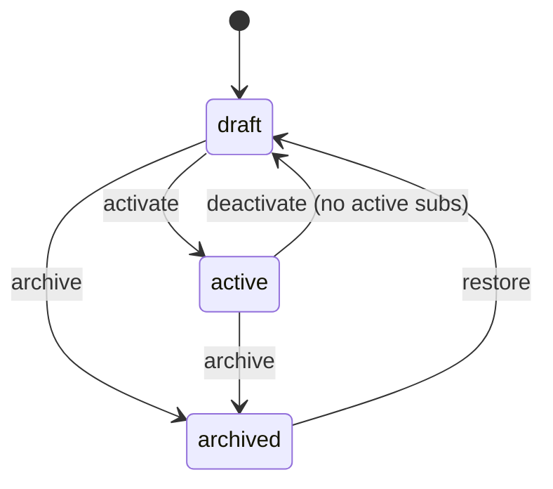
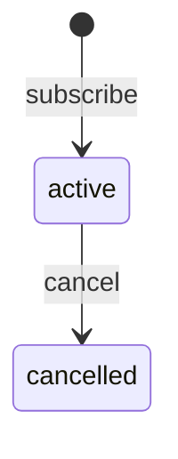
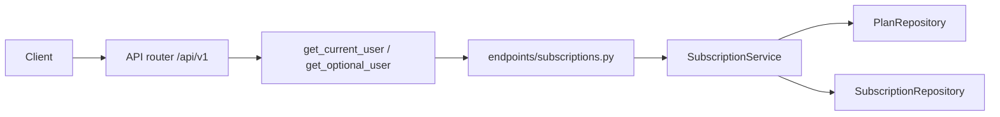

# FastAPI Subscriptions

An intermediate FastAPI service: JWT login, admin-managed billing plans, customer subscriptions, and a simple cancel flow. Users, plans, and subscriptions live in memory and reset when the process restarts.

Dependencies prove **who you are**. `PlanService` and `SubscriptionService` enforce catalog visibility, billing periods, and subscription privacy.

Interactive docs: [Swagger UI](/docs) and [ReDoc](/redoc). **POST /api/v1/subscriptions** includes a subscribe example.

## What you get

| Area | Behavior |
|------|----------|
| Auth | Register, login, refresh rotation, logout, `GET /api/v1/auth/me` |
| Plans | Public list is **active** only. Admins create drafts, edit, activate, deactivate, archive |
| Visibility | Draft and archived plans return **404** to non-admins |
| Subscribe | Signed-in users subscribe to active plans |
| Billing period | `current_period_start` / `current_period_end` (30 or 365 days by interval) |
| Uniqueness | One **active** subscription per user per plan |
| Cancel | Immediate **cancelled** status (no payment processor in this demo) |
| Privacy | Another user's subscription id returns **404**, not **403** |
| Tags | Public tag counts from active plans only |
| Errors | Domain failures return `{"detail": "..."}` with 401, 403, 404, or 409 |

## Roles

| | User | Platform admin |
|--|------|----------------|
| List active plans | Yes (no token) | Yes; may filter drafts/archived |
| View draft plan | **404** | Yes |
| Create / edit plans | No | Yes (edit drafts only) |
| Activate / deactivate / archive | No | Yes |
| Subscribe | Yes | Yes |
| List subscriptions | Own rows | All rows; per-plan roster |
| Cancel subscription | Own row | Any row |

## Plan status



## Subscription status



## Project layout

```
app/
  main.py                 # App factory, OpenAPI text, CORS, AppError handler
  core/                   # Settings, JWT + bcrypt, AppError types
  api/deps.py             # Bearer token, optional user, repository providers
  api/v1/endpoints/       # auth, users, plans, subscriptions, tags, health
  schemas/                # Pydantic models for plans and subscriptions
  repositories/           # In-memory plans and subscriptions
  services/               # Visibility, periods, cancel rules
tests/
  api/v1/                 # Auth, plans, subscriptions
```

### Request flow



## Setup

```bash
python -m venv .venv
source .venv/bin/activate
pip install -e ".[dev]"
cp .env.example .env
```

## Run

```bash
uvicorn app.main:app --reload
```

| URL | Purpose |
|-----|---------|
| http://127.0.0.1:8000/docs | Swagger UI |
| http://127.0.0.1:8000/redoc | ReDoc |

Seed catalog:

| | Value |
|--|--------|
| Admin | `admin@example.com` / `AdminPass123!` |
| Active plans | `starter-monthly` ($9.99/mo), `pro-yearly` ($99/yr) |
| Draft plan | `draft-internal` (404 without admin token) |

## Walkthrough

**Browse plans (no login)**

```bash
curl -s http://127.0.0.1:8000/api/v1/plans
curl -s http://127.0.0.1:8000/api/v1/plans/starter-monthly
```

**Register and subscribe**

```bash
curl -s -X POST http://127.0.0.1:8000/api/v1/auth/register \
  -H 'Content-Type: application/json' \
  -d '{"email":"you@example.com","password":"SecurePass1!","full_name":"You"}'

TOKEN=$(curl -s -X POST http://127.0.0.1:8000/api/v1/auth/login \
  -d 'username=you@example.com&password=SecurePass1!' | jq -r .access_token)

curl -s -X POST http://127.0.0.1:8000/api/v1/subscriptions \
  -H "Authorization: Bearer $TOKEN" \
  -H 'Content-Type: application/json' \
  -d '{"plan_slug":"starter-monthly"}'
```

**Cancel**

```bash
curl -s -X POST http://127.0.0.1:8000/api/v1/subscriptions/1/cancel \
  -H "Authorization: Bearer $TOKEN"
```

## API reference

| Method | Path | Who | Description |
|--------|------|-----|-------------|
| GET | `/api/v1/plans` | Public (+ optional bearer) | Active plans; admin may filter `status` |
| GET | `/api/v1/plans/{slug}` | Public (+ optional bearer) | One plan; hidden rows are 404 |
| POST | `/api/v1/plans` | Admin | Create draft |
| PATCH | `/api/v1/plans/{slug}` | Admin | Edit draft |
| POST | `/api/v1/plans/{slug}/activate` | Admin | `draft` → `active` |
| POST | `/api/v1/plans/{slug}/deactivate` | Admin | `active` → `draft` |
| POST | `/api/v1/plans/{slug}/archive` | Admin | Archive |
| POST | `/api/v1/plans/{slug}/restore` | Admin | `archived` → `draft` |
| GET | `/api/v1/plans/{slug}/subscriptions` | Admin | Subscribers for a plan |
| GET | `/api/v1/subscriptions` | Bearer | List subscriptions |
| GET | `/api/v1/subscriptions/{id}` | Bearer | One subscription (404 for others) |
| POST | `/api/v1/subscriptions` | Bearer | Subscribe |
| POST | `/api/v1/subscriptions/{id}/cancel` | Bearer | Cancel |
| GET | `/api/v1/tags` | — | Tags on active plans |

## Where the rules live

| Rule | Location |
|------|----------|
| Draft/archived visibility | `can_view_plan` in `app/services/plan_service.py` |
| Activate / deactivate / archive | `PlanService.transition` |
| Billing period length | `SubscriptionService._period_end` helper |
| One active sub per plan | `SubscriptionService.subscribe` |
| Subscription privacy | `SubscriptionService._can_view` |

## Tests and lint

```bash
pytest -v
ruff check app tests
```

## Docker

```bash
docker build -t fastapi-subscriptions .
docker run --rm -p 8000:8000 -e SECRET_KEY=your-production-secret fastapi-subscriptions
```

## What this demo is not

There is no Stripe, proration, trials, or webhooks. A production billing service would persist invoices, listen for payment events, and renew periods on a schedule — the **service layer** here is where those rules would grow.
